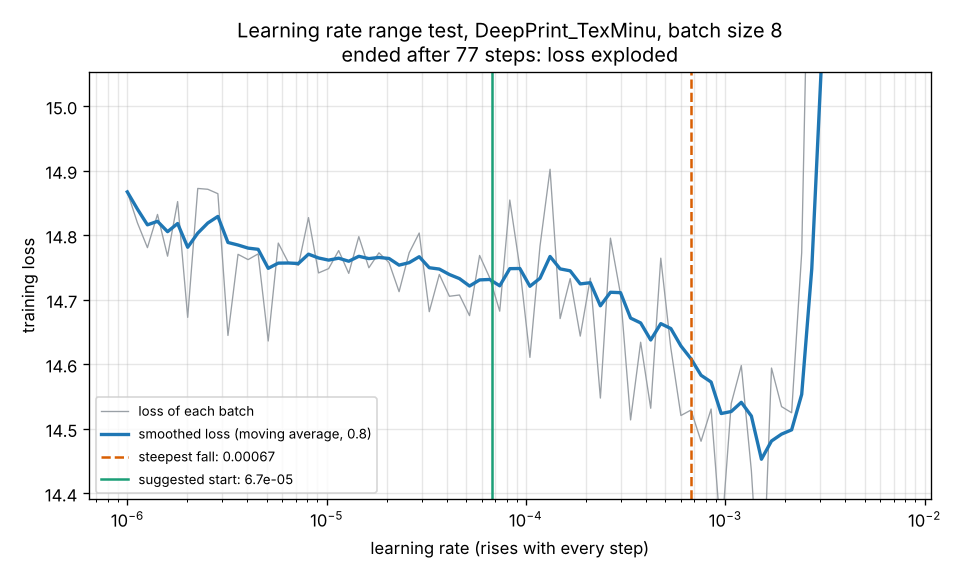

# Training Pipeline Setup Guide for Air-Gapped Networks

This guide takes you from a directory of fingerprint images to a trained DeepPrint model and its embeddings, with
your own data in an air-gapped environment. The route it describes uses three scripts of this repository:

1. `scripts/extract_minutiae.py` writes one minutiae file per image (optional, for the model variants with a
   minutia branch),
2. `scripts/find_learning_rate.py` suggests a learning rate,
3. `scripts/train_500k.py` trains the model.

Every command in this guide except the `torchrun` ones (several GPUs) was run at least once on a small set of
real prints on a CPU (12 and 32 images from three or four kinds of image files; the table
[What was run for this guide](#what-was-run-for-this-guide) lists each one and with which options). Nothing in it
was run on a GPU or on a large dataset. For large datasets read
[Above about one million subjects](#above-about-one-million-subjects) before you plan anything, and
[LARGE_SCALE_TRAINING_GUIDE.md](LARGE_SCALE_TRAINING_GUIDE.md).

## Table of Contents

1. [Prerequisites](#prerequisites)
2. [Dataset Preparation](#dataset-preparation)
3. [Training the Model](#training-the-model)
4. [Choosing the learning rate](#choosing-the-learning-rate)
5. [Loss weights](#loss-weights)
6. [Learned alignment](#learned-alignment)
7. [Validation and Testing](#validation-and-testing)
8. [Multi-GPU Training](#multi-gpu-training)
9. [Above about one million subjects](#above-about-one-million-subjects)
10. [Your own loader or training script](#your-own-loader-or-training-script)
11. [Troubleshooting](#troubleshooting)
12. [Quick Reference](#quick-reference)

---

## Prerequisites

Before starting, ensure you have:

1. Completed the air-gapped installation from [AIRGAP_INSTALLATION.md](AIRGAP_INSTALLATION.md)
2. Your fingerprint dataset transferred to the air-gapped environment
3. Python environment activated: `source venv/bin/activate`
4. For each image file: which finger it shows, and at which resolution (pixels per inch) it was captured

Run the commands of this guide from the root directory of the repository.

---

## Dataset Preparation

### Step 1: Lay out the files as `scripts/train_500k.py` reads them

`scripts/train_500k.py` finds the finger and the capture of an image in its file name:

```
data/fingerprints/my-dataset/
├── optical_500/
│   ├── 1_1.png        <- subject 1, impression 1
│   ├── 2_1.png
│   └── ...
├── optical_1000/
│   ├── 1_2.png        <- subject 1, impression 2
│   └── ...
└── capacitive_light/
    ├── 1_3.png
    └── ...
```

- The name is `<subject>_<impression>.png`, both whole numbers from 1.
- A **subject** is one finger. Two fingers of one person are two subjects, and all images of one finger have the
  same subject number, whatever sensor they come from. An **impression** is one image of that finger.
- Subjects are numbered 1 to `--num_subjects` **without gaps**, impressions 1 to `--num_impressions`, and **every
  subject needs all its impressions**. The script reads exactly these files.
- The files may be directly in the directory or in any subdirectories. Subdirectories per sensor, as above, make
  the resolution manifest short (see [Images from different sensors](#images-from-different-sensors)). The
  subdirectory is not part of the identity of a file: `optical_500/1_1.png` and `optical_1000/1_1.png` are the same
  subject and impression, and the script stops when it finds both.
- Files must be single fingers, 8-bit grayscale, as the sensor delivered them (not resized or enhanced).

Before it trains, the script compares the files with the two options. It stops with a message that names the first
missing files if some are not there, and it prints how many image files it does not use (subject number above
`--num_subjects` or impression number above `--num_impressions`).

If your data does not fit this layout:

- **Other names or another image format:** rename or link the files (a symbolic link per image is enough), or
  change `_extension` and `_file_to_id_fun` of `CustomFingerprintLoader` in `scripts/train_500k.py`.
- **A different number of images per finger:** the script cannot express that. Either choose `--num_impressions`
  as the smallest number that every finger has and number the images of each finger from 1 (the others are not
  used), or leave out fingers with fewer images and renumber the subjects without gaps. Fingers with a single
  image cannot be used for validation and cannot be used by this script at all.
- **Multi-finger images** (four-finger slaps) must be cut into single fingers first.

### Step 2: Understand the Identifier System

Inside the `flx` package a sample is named by an `Identifier`:

- **Subject**: a distinct finger (one class during training)
- **Impression**: a single capture of that finger

Both are **zero-indexed** in the code, one less than the numbers in the file names: `17_3.png` is
`Identifier(subject=16, impression=2)`.

```python
from flx.data.dataset import Identifier

# First subject (finger), second impression: the file 1_2.png
my_id = Identifier(subject=0, impression=1)
```

### Step 3: Prepare Minutiae Data (Optional)

Minutiae data is required for training the variants with a minutia branch (`TexMinu`, `LocTexMinu`).

#### Option A: Extract Minutiae Using FingerFlow

If you have the FingerFlow models (see [AIRGAP_INSTALLATION.md](AIRGAP_INSTALLATION.md)):

```bash
python scripts/extract_minutiae.py \
  --input_dir data/fingerprints/my-dataset \
  --output_dir data/poses/my-dataset \
  --coarse_net path/to/CoarseNet.h5 \
  --fine_net path/to/FineNet.h5 \
  --ppi_manifest data/fingerprints/my-dataset-resolutions.csv \
  --skip_existing \
  --workers 1
```

This creates one `.mnt` file with minutiae coordinates and angles per image, in the same directory structure as the
images. The script needs the `fingerflow` package of the minutiae_extractor repository
(https://github.com/craig-forefront/minutiae_extractor) in a revision whose `Extractor` has the `image_dpi` option
and accepts `None` for the ClassifyNet and CoreNet paths: its branch `claude/serene-albattani-s6ehsj` (commit
"Make ClassifyNet and CoreNet optional in the Extractor" or later), or its `main` once that branch is merged. The
`fingerflow` release on PyPI and older checkouts do not work: the script then stops at the first image with exit
status 2 and a message that names the branch. [AIRGAP_INSTALLATION.md](AIRGAP_INSTALLATION.md) says how to get it.
The script needs Pillow, and it does not need torch, so it runs in the environment of the extractor.

The next section, "Images from different sensors", explains the options for resolution and ridge polarity, which you
must set, and how to run the extraction over a very large number of files. The rest of this section describes the
output.

- Feed the image files as the sensor delivered them: 8-bit grayscale, not resized or enhanced. The script resamples
  them to 500 ppi itself. The header of the `.mnt` file holds the size of the 500 ppi image, and the coordinates are
  in its pixels.
- `--classify_net` is optional. ClassifyNet assigns a type (ending, bifurcation, ...) to every minutia. DeepPrint does
  not read the type, so leave the option out: the class index in the file is then -1 and the extraction is faster.
  Measured on this machine (CPU, one worker, 8 prints at 500 ppi with 369 minutiae, other jobs running, so the times
  are rough): 153 seconds without and 263 seconds with ClassifyNet, and the same 369 positions, angles and
  confidences in both runs. CoreNet is never run, because the script never wrote its result (`--core_net` is accepted
  and ignored).
- `--image_dpi` is only used to find the direction of the minutiae, and it refers to the image after the resampling.
  Leave it at 500; it is not the option for the resolution of the files (that is `--ppi`), and the script prints a
  warning when it is not 500. (If you give the script a resolution that is not the true one, for example `--assume_ppi 500` for
  the 292x392 SFinGe example images of this repository, whose ridge period of about 8 px corresponds to about 420 ppi,
  the ridge period of the resampled image is off, and `--image_dpi` can correct the direction step for it: roughly
  `500 * period_px / 9.5`. The setting is tolerant: values up to 50 below or above the suitable one gave the same
  accuracy on those images and on 500 ppi prints.)
- Extract all `.mnt` files of a dataset with the same settings, and extract them again when the settings or the
  extractor change. The script stores its settings in `extraction_settings.json` in the output directory and refuses
  to add files with other settings to it. Files from before the direction refinement have unreliable minutia
  directions.
- Each row is `x y angle class direction_confidence`. The angle is in radians, the direction vector is
  `(cos(angle), sin(angle))` with y pointing down. This is the convention of the minutia maps, the
  `FingerFlowMinutiaMapLoader` uses the angle as it is. Do not remove minutiae with a low `direction_confidence`
  when building minutia maps: it only rates the direction, the minutia itself is still there. The last line of the
  file starts with `#` and records how the image was prepared, for example
  `# source 826x1274 at 1000 ppi (manifest), ridges dark (argument), prepared 413x637`. The loaders do not read it.

### Images from different sensors

This section applies when the prints come from more than one kind of sensor, or from any sensor that is not a 500 ppi
sensor with dark ridges. "ppi" means pixels per inch, the resolution of the image. "Ridge polarity" says whether the
ridges of the finger are the dark or the light lines of the image.

**Why it matters.** The minutiae extractor only works near 500 ppi and expects dark ridges on a light background. It
does not rescale or invert anything, and it does not fail on other images: it silently returns few and wrong
minutiae. On 8 NIST SD 302 prints (5 rolled, 3 slap, 688 minutiae marked by examiners, a minutia counts as found
when the extractor reports one within 10 pixels at 500 ppi):

| Image file given to `scripts/extract_minutiae.py` | Examiner minutiae found | Reported minutiae that are examiner minutiae | Same as from the 500 ppi file |
|---|---|---|---|
| 500 ppi file | 42.7 % | 79.7 % | |
| 1000 ppi file of the same print, resolution from the file metadata | 42.6 % | 79.0 % | 98.6 % |
| 385 ppi file of the same print (made from the 1000 ppi file) | 44.8 % | 78.4 % | 88.1 % |
| 1000 ppi negative of the same print, declared as light ridges | 42.4 % | 78.9 % | 98.4 % |
| 1000 ppi file declared as 500 ppi, which is what happened before the resampling existed (7 prints) | 5.3 % | 27.2 % | 5.6 % |

Eight prints show that the preparation works; they are not an accuracy figure for your data. The 385 ppi row comes
from images that were first shrunk and then enlarged again, which loses detail; a real 385 ppi sensor was not
available.

**What the scripts do.** `scripts/extract_minutiae.py`, `scripts/train_500k.py` and `scripts/find_learning_rate.py`
load every image file through the same function (`SensorNormalizer.load` in
`flx/preparation/sensor_normalization.py`). It resamples the image to 500 ppi and, if the file is declared to have
light ridges, inverts it. A file that is at 500 ppi with dark ridges is used unchanged, bit for bit. Because the
extraction and the training load the file in the same way, the minutiae in a `.mnt` file are in the pixels of the
image that the training loads. **Give all three scripts the same options.**

**Where the resolution of a file comes from**, in this order:

1. `--ppi 1000`: all files have this resolution. Use it only for a dataset from one kind of sensor.
2. `--ppi_manifest FILE`: a CSV file with a row per file or per directory. This is the option for mixed sensors.
3. The metadata of the image file (PNG, TIFF, JPEG and BMP files can store their resolution). A value is only used
   if it is between 200 and 2100 ppi, because image programs write 72 or 96 into files without knowing the sensor.
   The example images in `tests/data/SFingeExample` state 96 ppi, for instance.
4. `--assume_ppi 500`: for the files that are still without a value.

If none of the four gives a value, the file fails with a message that names these options. The scripts never guess a
resolution. With `--assume_ppi` you take the responsibility that the files without a value really have that
resolution.

**`--assume_ppi` does not override the metadata of a file.** A file that states a value between 200 and 2100 ppi is
resampled by that value, also when `--assume_ppi` is given. Image programs do not only write 72 or 96: a 500 ppi
print that was saved with a 300 or 600 ppi stamp is enlarged or shrunk, in the extraction and in the training
alike, so nothing else notices. Measured on one 300x400 file with `--assume_ppi 500`: with a stamp of 300 it was
resampled to 500x667, with 600 to 250x333, with 96 it was left unchanged. Therefore:

- For a dataset of **one known resolution**, use `--ppi`. It wins over the metadata.
- For mixed sensors, use the manifest. A manifest row also wins over the metadata.
- Read the counts that the scripts print. The extraction ends with "Resolution of the files extracted in this
  run", the training starts with "Resolution of ... training images" (up to 1,000 files spread over the set): one
  line per source and value, and a note when files took their resolution from metadata although `--assume_ppi`
  was given.

The manifest has a header line and the columns `path`, `ppi` and optionally `ridges`. Paths are relative to the image
directory (`--input_dir` of the extraction, `--dataset_dir` of the training). A row for a directory applies to all
files below it; the row of a file wins over that of its directory. If the files of each sensor are in their own
directory, the manifest has one row per sensor:

```
path,ppi,ridges
optical_500,500,dark
optical_1000,1000,dark
capacitive_385,385,light
optical_500/retakes/7_3.png,1000,
```

If your sensors are not separated by directory, write one row per file. Every process reads the manifest into
memory, which took 186 bytes per row for a manifest of 1 million file rows with paths of about 35 characters. For
100 million file rows that is about 19 GB per process, so for a dataset of that size directory rows are the
practical form.

**Ridge polarity.** `--ridges dark` (the default) uses the files as they are. `--ridges light` inverts all files.
`--ridges auto` decides per image: the scripts compare the gray level of the background (blocks of the image with
little contrast) with that of the print, and take the image as light-ridged if the background is darker. A `ridges`
value in the manifest wins over the option. Prefer the manifest: a sensor delivers one polarity, so one row per
sensor is exact, while the estimate needs background in the image. Measured on 1708 NIST SD 302 exemplars from 5
devices at 500 ppi, each as it is and as its negative, the estimate was right for all 3416 images. On the centre
third of the same images, which shows little or no background, it gave no decision for 549, was right for 1148 and
wrong for 11. Without a decision, `auto` takes the image as dark-ridged.

The extraction checks every image with the same estimate, whatever the setting. An image that looks different from
what it was declared to be is still extracted, and it is listed with the reason in `extraction_warnings.txt` in the
output directory (with shards: `extraction_warnings.shard-00000-of-00064.txt`, one file per shard; a run without
warnings leaves no file). Read that file after the first shard: many entries from one sensor mean that its
polarity is declared wrongly.

**Different image sizes.** The sensors may deliver images of different sizes; every `.mnt` file carries the size of
its own image. By default the training pads every 500 ppi image to a square of its own longer side and scales that to
the model input of 299x299 pixels. A 256x360 image of a small sensor is then shown 2.2 times larger than a 800x750
rolled print, although both are at 500 ppi. To show all sensors at one scale, give the training
`--canvas_size N`: every 500 ppi image is cut or padded around its centre to N x N pixels before it is scaled, and
the minutiae are moved with it. Things to know before you choose N:

- The scale of the model input is 299 / N. With N = 512 a ridge period of about 9.5 pixels at 500 ppi becomes about
  5.5 pixels; with N = 800 about 3.6 pixels.
- Whatever is outside of the N x N square around the centre of the *image* (not of the print) is cut off. A rolled
  print of 800x750 pixels loses its sides with N = 512, and a print that is not in the middle of its image can lose
  more. Of the two real prints that were looked at with N = 512, the slap print (603x842 pixels at 1000 ppi) was
  complete, and the rolled print (1600x1500 pixels at 1000 ppi), which lies in the lower left of its image, lost a
  large part.
- Whether a canvas, and which N, gives better matching was not measured here. It needs a comparison on your data: two
  trainings that differ only in `--canvas_size`, compared by their validation equal error rate, as described for the
  learned alignment in "How to find out whether it helps on your data".
- The default is 0 (no canvas), which is the behaviour before this option existed.

The training writes its preparation settings to `training_settings.json` (and, alone, to `data_preparation.json`)
in the output directory. When the trained model is used later, the images must be prepared in the same way;
`load_trained_model` in `scripts/train_500k.py` builds the loader from that file, see
[Step 9](#step-9-extract-embeddings). A training that is continued with another preparation stops, see
[Step 7](#step-7-continue-a-training-or-start-again).

**A check against mixed-up data.** The training compares the image size in the header of each `.mnt` file with the
size of the image that it loaded. If they do not fit (the image file was replaced, or extraction and training were
given different options), it stops with a message that names the sample and both sizes. Without `--canvas_size`
only a different shape (ratio of width to height) is an error, because image and minutiae are both scaled by the
longer side, so the same picture at another resolution still fits. With `--canvas_size` the sizes must be equal.

**If you write your own image loader** instead of using `scripts/train_500k.py` (see
[Your own loader or training script](#your-own-loader-or-training-script)), load the files with
`SensorNormalizer.load` there as well, as `CustomFingerprintLoader` in that script does. A loader that reads the
files directly gets images in other pixels than the `.mnt` files for every sensor that is not at 500 ppi.

#### Running the extraction over a very large number of files

The extraction is the slow step. On the 4 CPU cores of the machine used here, without a GPU, one process needed
19 seconds per print without ClassifyNet and 33 seconds with it (8 prints each, model loading included, other jobs
running). No GPU was available, so the speed on your hardware must be measured: time one shard of a few hundred
files before you choose the number of shards. Plan the extraction as a job that runs on many machines, is
interrupted and is continued.

1. **Make the file list once**, so that every process works on the same list in the same order:

   ```bash
   (cd data/fingerprints/my-dataset && find . -name '*.png' | sort > ../my-dataset-files.txt)
   ```

   The parentheses keep your shell in the repository root, where the next commands must be started.

   Without `--file_list` the script walks the image directory in sorted order itself, which gives the same list as
   long as no file is added or removed.

2. **Start one process per shard.** A shard is one of N equal parts of the list: shard I holds the files number I,
   I + N, I + 2N, ... (counted from 0). Every file is in exactly one shard.

   ```bash
   python scripts/extract_minutiae.py \
     --input_dir data/fingerprints/my-dataset \
     --file_list data/fingerprints/my-dataset-files.txt \
     --output_dir data/poses/my-dataset \
     --coarse_net path/to/CoarseNet.h5 --fine_net path/to/FineNet.h5 \
     --ppi_manifest data/fingerprints/my-dataset-resolutions.csv \
     --num_shards 64 --shard_index 0 \
     --skip_existing
   ```

   Run the same command with `--shard_index 1` to `63` on the other machines or GPUs. All shards write into the same
   output directory. `--workers W` starts W worker processes inside one shard; each loads its own copy of the
   networks, so on a GPU keep it at 1 unless the memory allows more.

3. **Continue after an interruption** by running the same command again. With `--skip_existing`, images that already
   have a `.mnt` file are left out. A `.mnt` file is written under a temporary name and renamed when it is complete,
   so a file with the ending `.mnt` is always a finished one, also after a crash. Without `--skip_existing` every
   file is extracted again.

4. **Look at the failures.** One bad file never stops the run. Each failure is written at once to
   `extraction_errors.shard-00000-of-00064.txt` (`extraction_errors.txt` without shards) in the output directory:
   the path, a tab, and the reason, for example an unreadable file, an unknown resolution or an error inside the
   extractor. The exit status of the process is 1 if any file of its run failed, 0 if none did, and 2 if the run did
   not start (settings differ from those stored in the output directory, or the minutiae extractor is too old). Every run starts its log anew; with
   `--skip_existing` the log then lists exactly the files of the shard that still have no `.mnt` file. If a worker
   process dies (for example because the machine runs out of memory), the files that were being worked on are logged
   as failed and the run goes on with new processes; this happened once in the runs for the table above. Remove the
   cause and run the command again to extract only the failed files.

5. **Check that it is complete** before the training: run every shard once more with `--skip_existing`. Each should
   end with "Successful: 0", "Failed: 0" and exit status 0. The training needs a `.mnt` file for every image that it
   trains on, and stops before the first epoch with the names of the first missing ones. Images that can not be
   extracted must be taken out of the dataset; because the subjects must be numbered without gaps (Step 1), that
   means renumbering, or replacing the image. A print for which the extractor finds no
   minutia gets a `.mnt` file with 0 minutiae; the training leaves it out of the minutia map loss and uses it for
   the rest (see "Loss weights"). The script prints how many there were.

Not covered by the scripts: the image loader of `scripts/train_500k.py` reads one file extension (`.png` unless you
change `_extension`), while the extraction reads PNG, JPEG, BMP and TIFF files. Convert the files to one format, or
adapt the loader. Multi-finger images must be cut into single fingers before both steps.

#### Option B: Use Texture-Only Models

If you don't have minutiae data, leave `--minutiae_dir` out of the training command. The script then trains a
texture-only variant (`LocTex`, or `Tex` with `--localization off`), which does not need minutiae.

---

## Training the Model

### Step 4: Choose the model variant and the embedding size

`scripts/train_500k.py` trains one of four DeepPrint variants. Two options choose it:

| Variant | `--minutiae_dir` | `--localization` | Minutiae needed |
|---------|------------------|------------------|-----------------|
| `DeepPrint_LocTexMinu` | given | `on` (the default) | yes |
| `DeepPrint_TexMinu` | given | `off` | yes |
| `DeepPrint_LocTex` | not given | `on` (the default) | no |
| `DeepPrint_Tex` | not given | `off` | no |

- `Tex` is the texture branch, `Minu` the minutia branch, `Loc` the localization network (a learned alignment of
  the image).
- Without `--minutiae_dir` the script trains a texture-only variant and says so in its first lines. If you
  extracted minutiae, give the option.
- Whether the localization network makes matching more accurate depends on the data and has to be measured: see
  [Learned alignment](#learned-alignment) for how it works, what keeps it stable and how to compare a training
  with and without it.

**Embedding size.** `--embedding_dim` is the number of values **per branch** (default 256). A variant with
minutiae has two branches, so the embedding of a print has twice that many values: 512 with the default. A
texture-only variant has 256 with the default. The paper behind this repository found 512 values best for the
texture-only variant on its data; what is best on your data was not measured here. Smaller embeddings need less
memory in the classifier (see [Above about one million subjects](#above-about-one-million-subjects)) and in the
gallery.

### Step 5: Find a learning rate

Run `scripts/find_learning_rate.py` with the options of the planned training, as described under
[Choosing the learning rate](#choosing-the-learning-rate). The default of 0.0001 did not diverge in the short
runs made here; it is not known to be the best rate for your data.

### Step 6: Run the training

One complete command for a dataset of 50,000 fingers with 10 images each, with minutiae and a resolution manifest:

```bash
python scripts/train_500k.py \
  --dataset_dir data/fingerprints/my-dataset \
  --minutiae_dir data/poses/my-dataset \
  --num_subjects 50000 --num_impressions 10 \
  --ppi_manifest data/fingerprints/my-dataset-resolutions.csv \
  --learning_rate 0.0001 --lr_schedule cosine \
  --num_epochs 10 \
  --output_dir models/my-model-v1
```

- `--num_subjects` and `--num_impressions` must be what the directory holds (Step 1). They have defaults
  (50,000 and 10), but always give them.
- `--ppi_manifest` (or `--ppi`, `--assume_ppi`, `--ridges`) must be exactly what the minutiae extraction was
  given, see [Images from different sensors](#images-from-different-sensors). Without any of them a file that
  does not state its resolution stops the script.
- `--learning_rate` is the value from Step 5. All learning rate options are explained under
  [Choosing the learning rate](#choosing-the-learning-rate).
- `--batch_size` is the number of images per step on each GPU (default 64). Lower it if the GPU runs out of
  memory. The range test of Step 5 must use the batch size of the training.
- Validation is on by default: 10 % of the subjects, at most 5,000, are held out (see
  [Which epoch becomes `best_model.pyt`](#which-epoch-becomes-best_modelpyt)). `--validation_split 0` trains
  without validation.
- On several GPUs, put `torchrun --nproc_per_node=NUM_GPUS` in place of `python` (see
  [Multi-GPU Training](#multi-gpu-training)).
- `python scripts/train_500k.py --help` lists all options; the docstring at the top of the script describes them.

**How many epochs.** `--num_epochs` is an upper limit (default 10); with validation the training stops earlier
when the validation error rate has not fallen for `--patience` epochs (default 3). How many epochs a large
dataset needs was not measured here. The trainings of the paper, on 60,000 synthetic images, ran for up to 100
epochs; with far more images per epoch fewer are needed. With `--lr_schedule cosine` the learning rate falls over
exactly `--num_epochs` epochs, so set the number once and do not change it in a running training.

**What the script prints first** (shortened; from the run on 12 images of 4 fingers that is listed at the end of
this guide):

```
============================================================
Training DeepPrint with Learned Alignment (LocTexMinu (texture + minutiae))
============================================================
Dataset:      data/fingerprints/my-dataset
Minutiae:     data/poses/my-dataset
Images:       resampled to 500 ppi; resolution from manifest (3 rows), file metadata, else the file fails; ridges dark
Canvas:       square of the longer side of each image
Batch size:   4 images per step and GPU
Subjects:     4 total
  Training:   2 subjects
  Validation: 2 subjects held out (seed 42)
Impressions:  3
...
Embedding:    256 values per branch, 512 per print
...
Scanning data/fingerprints/my-dataset for .png files...
Resolution of 6 training images spread over the set:
             4  1000 ppi from manifest (resampled to 500 ppi)
             2  500 ppi from manifest
```

Read these lines before you let a long training run: the variant, the number of training subjects, and where the
resolution of the images comes from. The last block looks at up to 1,000 training images. If it shows files that
took a resolution "from metadata of the file" which you did not expect, see
[Images from different sensors](#images-from-different-sensors).

**What the script writes** to `--output_dir`:

| File | Content |
|------|---------|
| `model.pyt` | The model, the loss and the optimizer after the newest epoch. The training continues from it |
| `best_model.pyt` | A copy of `model.pyt` of the best epoch so far |
| `log.json` | One entry per epoch, see [Step 8](#step-8-monitor-training-progress) |
| `training_settings.json` | The settings of the training, as of the last run that trained an epoch. Needed to continue it and to load the model later |
| `data_preparation.json` | The image preparation settings alone (also part of `training_settings.json`) |

### Step 7: Continue a training, or start again

**The same command continues.** If `--output_dir` holds a `model.pyt`, the script loads it and trains the next
epoch. This is how you continue after an interruption: run the same command again. A training that was stopped
in the middle of an epoch starts that epoch again from the end of the one before; if it was stopped while an epoch
was being validated, that epoch is validated first.

**To start again from nothing, use a new `--output_dir`** (or delete the old directory). There is no option
that overwrites a training.

**A continued training must be the same training.** The script compares its options with
`training_settings.json`:

- It **stops** (exit status 2, with the list of differences) if one of these differs: the variant
  (`--localization`, `--minutiae_dir` given or not), `--embedding_dim`, `--num_subjects`, `--num_impressions`,
  the validation options, `--batch_size`, `--canvas_size`, or the image preparation (`--ppi`, the content of the
  manifest, `--assume_ppi`, `--ridges`). Train with such a change in a new `--output_dir`.
  `--allow_changed_settings` continues anyway; use it only if you know that the change is harmless (for example a
  smaller `--batch_size` after the GPU ran out of memory).
- It **continues and lists the changes** if only these differ: the learning rate options, the loss weights,
  `--num_epochs`, `--patience`. They hold from the next epoch on. `--localization_lr_factor` is one of them: a
  continued training uses the factor of the new command.
- **If nothing is left to train**, the script says "Nothing was trained in this run". That is the case when the
  log already has `--num_epochs` epochs, or when the training ended by early stopping. A changed learning rate
  has no effect on a finished training. What trains further epochs depends on how it ended, and the script's
  message says which case it is:
  - the log has `--num_epochs` epochs: raise `--num_epochs`;
  - it ended by early stopping (`--patience` epochs without a lower error rate): raise `--patience` (or pass
    `--patience 0`); a larger `--num_epochs` alone trains nothing;
  - or use a new `--output_dir` to train again from the start.

So "divide the learning rate by 3 and start again", as the sections below sometimes advise, means: a new
`--output_dir` if you want a new training, the same one if you want to continue from the last saved epoch with
the lower rate.

The settings files are written when a new training starts, after the file check, and again after every run that
trained an epoch. A start that is refused, or that trains nothing, does not change them, and a refused first start
leaves the output directory empty. The changes that the script lists are therefore changes against the last run
that trained.

If a run was stopped while `best_model.pyt` was being written, the next start writes it again from `model.pyt`
(it prints "best_model.pyt: epoch N ... copied again"). While `model.pyt` or `best_model.pyt` is written, a file
`model.pyt.tmp` or `best_model.pyt.tmp` of the same size exists; a process that is killed outright can leave it
behind, and the next save overwrites it.

A directory that was written before `training_settings.json` existed is continued with a note; only its image
preparation can be compared.

---

## Choosing the learning rate

### What the learning rate is

Training repeats one small action millions of times. The model looks at a
handful of images (a *batch*), a number called the *loss* says how wrong its
answers were, and the optimizer changes every parameter of the model a little
in the direction that makes the loss smaller. One such action is a *step*.

The *learning rate* is the size of that change. It decides whether a
training works at all:

- **Too low:** every step changes almost nothing. The loss falls very slowly
  or not at all, and GPU time is wasted.
- **Too high:** every step overshoots. The loss jumps up instead of down, the
  next step is computed from a worse model and overshoots further, and within
  a few steps the loss is in the thousands or is no longer a number ("NaN").
  The training has then *diverged* and the model is useless.
- **About right:** the loss falls steadily, with some noise from batch to
  batch.

This repository uses the Adam optimizer. In its first step Adam changes
every parameter by about the learning rate itself, whatever the data look
like. In a fresh `DeepPrint_LocTexMinu` model, 93 % of the 68 million
parameters are smaller than 0.025 in size, so the former default of 0.025
changed most parameters by more than their own size in the first step. On
real fingerprint images it destroyed the training at once: the loss was 14.9 in the first step and 5,717
in the second (one run, 8 images per step). With 0.01, the value that
LARGE_SCALE_TRAINING_GUIDE.md used to recommend, the loss was 690 in the
third step.

### What warm-up does

At the start the model is random, and the direction that the optimizer
computes from the first few batches is unreliable. *Warm-up* means that the
training starts with a tiny learning rate and raises it in a straight line,
step by step, until it reaches the chosen learning rate. During these steps
the model moves carefully into a region where larger steps are safe.

The warm-up is counted in steps (default: 500). It is never longer than a
tenth of the whole training, so a short training on a small dataset still
reaches the chosen rate; the training prints the number of warm-up steps it
uses. For a large training set, 500 to 2,000 steps are a tiny part of the
first epoch.

After the warm-up there are two choices (the *schedule*):

- `constant`: the rate stays at the chosen value.
- `cosine`: the rate falls smoothly and reaches 1 % of the chosen value in the
  last step of the last epoch. Large steps at the start find a good region
  quickly, small steps at the end settle into it. This is common practice for
  long trainings; whether it gives a lower error rate than `constant` on your
  data was not measured here and is worth one comparison.

### Where the settings are

| Setting | `scripts/train_500k.py` | Default in `flx/setup/config.py` |
|---------|------------------------|----------------------------------|
| Learning rate after the warm-up | `--learning_rate` | `LEARNING_RATE = 0.0001` |
| Number of warm-up steps | `--warmup_steps` | `LEARNING_RATE_WARMUP_STEPS = 500` |
| Schedule after the warm-up | `--lr_schedule constant` or `cosine` | `LEARNING_RATE_SCHEDULE = "constant"` |
| Upper limit for the gradient (see below) | `--gradient_clip_norm` | `GRADIENT_CLIP_NORM = None` (no limit) |
| Stop when the loss is this many times the starting loss | (config only) | `LOSS_EXPLOSION_FACTOR = 10.0` |
| Factor of the learning rate of the localization network (`Loc` variants only, see [Learned alignment](#learned-alignment)) | `--localization_lr_factor` | `LOCALIZATION_LEARNING_RATE_FACTOR = 0.035` |

`scripts/train_500k.py` passes these options on. If you call `fit` yourself, pass the settings to it:

```python
from flx.models.learning_rate import LearningRateConfig

extractor.fit(
    ...,
    learning_rate=LearningRateConfig(
        learning_rate=1e-4, warmup_steps=1000, schedule="cosine"
    ),
)
```

*Gradient clipping* is a safety belt. The *gradient* is the list of changes
that the optimizer would like to make in one step; its *norm* is the overall
length of that list. With a limit, a step whose gradient is longer than the
limit is scaled down to the limit, so a single bad batch cannot throw the
model far away. It is off by default, and the stability runs below did not
use it. If you use one, take it from your own range test: the column
`gradient_norm` of `lr_range_test.csv` holds the gradient norm of every step,
and a limit of a few times the typical value in the falling part of the curve
only acts on unusual batches. In the range test here with the current loss
the norm was between 10,000 and 15,200 at rates up to 0.0001 and fell to a
few hundred near 0.001, so a limit such as 1.0 from other projects would
shrink every single step.

The training follows the schedule by counting steps, so it continues
correctly when you continue a training from `model.pyt`
([Step 7](#step-7-continue-a-training-or-start-again)), as long as the number
of epochs, the training set, the batch size and the number of GPUs are the
same as before. If you continue with a larger number of epochs, the `cosine`
schedule is stretched to the new length and the rate jumps back up; prefer to
set the number of epochs once. `scripts/train_500k.py` points this out when
it happens. In a multi-GPU training all processes use the same rate.

### How to run the range test

The right learning rate depends on the data, the model variant and the batch
size. `scripts/find_learning_rate.py` finds a starting value. It trains a
fresh model on a subset of your data for a few hundred steps and multiplies the learning rate by a constant factor after
every step, from far too low (0.0000001) to far too high (1). It reads the
same directory layout as `scripts/train_500k.py` and saves no model.

```bash
python scripts/find_learning_rate.py \
    --dataset_dir data/fingerprints/my-dataset \
    --minutiae_dir data/poses/my-dataset \
    --num_subjects 50000 --num_impressions 10 \
    --max_subjects 2000 \
    --batch_size 64 \
    --ppi_manifest data/fingerprints/my-dataset-resolutions.csv \
    --output_dir models/lr_range_test
```

- `--ppi_manifest` (or `--ppi`, `--assume_ppi`, `--ridges`, `--canvas_size`) must be what the minutiae extraction
  and the planned training use, see "Images from different sensors". Without any of them, a file that does not
  state its resolution stops the test.
- `--max_subjects 2000` uses a random 2,000 of the subjects. The test needs
  `--num_steps` times `--batch_size` images (19,200 with the defaults); a
  subset with at least that many images is enough.
- `--batch_size` must be the `--batch_size` of the planned training (both
  scripts default to 64). The script reads the same file layout as the
  training and stops with the same message when files are missing.
- `--variant` chooses the model (`LocTexMinu`, `TexMinu`, `LocTex`, `Tex`).
  Without it the script tests what `train_500k.py` trains by default. For a
  training with `--localization off`, test `TexMinu` or `Tex`.
- `--localization_lr_factor` must be the value of the planned training
  (`Loc` variants only).
- `--gradient_clip_norm` must be the value of the planned training.
- `--seed` changes the subset, the starting model and the order of the
  images. Run the test with two or three seeds, look at the plots and take
  the lowest suggestion (see "How far to trust the suggestion" below).

The script writes `lr_range_test.csv` (learning rate and loss of every step),
draws `lr_range_test.png` and prints a suggested rate.

### How to read the plot



The picture is the range test of `DeepPrint_TexMinu` on 440 real images with
8 images per step, made with the former loss weights (see "What was measured
here" below). The fall is shallow
because the test is short and the data set is tiny.

The horizontal axis is the learning rate; each tick is ten times the one
before. The grey line is the loss of each batch, the blue line is its moving
average. Read it from left to right:

1. **Flat part on the left.** The rate is too low to change the model in so
   few steps. The loss stays at its starting value.
2. **Falling part.** The model learns. The further right, the faster.
3. **Lowest point and rise on the right.** The rate is too high. The test
   ends when the average loss is four times its lowest value or is no longer
   a number.

A good learning rate lies in the falling part, clearly left of the lowest
point. The lowest point itself is not a good choice: the loss is low there
because of all the steps before it, and the next steps diverge. The script
suggests one tenth of the rate with the lowest smoothed loss (green line).
The factor of ten is a safety margin, because a real training runs thousands
of times longer than the test and an instability can take longer than the
test to show. The script also marks the rate where the loss fell fastest
(orange, dashed) for information; it does not use it (see below). The example
picture above was drawn with an earlier rule, so its green line is at a tenth
of the orange one.

If the plot has no flat part on the left, start lower (`--min_lr`). If the
loss never falls, no rate is suggested: look for a problem in the data or the
labels before you look at the learning rate.

**Variants with minutiae look different.** Their loss contains the minutia
map loss (see [Loss weights](#loss-weights)), which falls from the first step
at any learning rate: a model that has not learned anything draws a map that
is far from empty, and tiny changes correct that. The curve then has no flat
part and falls evenly from the left edge to the lowest point, and the place
of the steepest fall says nothing about the learning rate. Starting lower
does not help in this case. This is why the suggestion is taken from the
rate with the lowest loss and not from the steepest fall.

### How far to trust the suggestion

The suggestion is a starting point, not a measurement of the best rate. All
range tests of minutiae variants that were stored while this was written are
in the table. They are short (at most 100 planned steps), use 4 or 8 images
per step and differ in more than the seed, so the spread is an upper
estimate for one setting; no test was run at the script defaults (300 steps
of 64 images), which should be less noisy.

| Test (one run each) | Steps done | Lowest smoothed loss at | Steepest fall at | Suggestion (lowest / 10) | An earlier rule based on the steepest fall gave |
|---|---|---|---|---|---|
| `LocTexMinu`, 220 fingers, batch 4, seed 1 | 67 | 0.00095 | 0.000105 | 0.000095 | 0.0000105 |
| `LocTexMinu`, 220 fingers, batch 4, seed 2 | 73 | 0.0027 | 0.0000102 | 0.00027 | 0.00027 |
| `LocTexMinu`, 60 fingers, batch 4, 30 steps planned | 23 | 0.0013 | 0.0000161 | 0.00013 | 0.0000016 |
| `TexMinu`, 220 fingers, batch 8, current loss weights | 69 | 0.0015 | 0.0000115 | 0.00015 | 0.00015 |
| `TexMinu`, 220 fingers, batch 8, former loss weights | 77 | 0.0015 | 0.0011 | 0.00015 | 0.00011 |
| `LocTexMinu`, 220 fingers, batch 8, former loss weights | 79 | 0.0022 | 0.00067 | 0.00022 | 0.000067 |

- The suggestions are between 0.000095 and 0.00027, a factor of 2.8 apart.
  The first two rows differ only in the seed and are a factor of 2.8 apart.
- The rule that followed the steepest fall gave 0.0000016 to 0.00027 for the
  same six tests, a factor of 170 apart, and a factor of 26 between the two
  seeds. That rule was replaced.
- So: expect the suggestion to move by a factor of about 3 from one seed to
  the next. Run two or three seeds, take the lowest suggestion, and let the
  plot and the first thousand steps of a real training decide. A rate that
  is 3 times too low costs training time; one that is too high can end the
  training.

### What was measured here, and what was not

The default learning rate of 0.0001 comes from runs on the only real data
that was available when this was written: 440 images of 220 fingers (two
impressions each, rolled and slap prints from five devices of NIST Special
Database 302, with minutiae marked by examiners), on a CPU, with 8 images per
step. Each line is one run.

| Run | `DeepPrint_TexMinu` | `DeepPrint_LocTexMinu` |
|-----|--------------------|------------------------|
| Range test, 100 steps from 0.000001 to 0.1: smoothed loss above 15 (start: 14.8) from | 0.0031 | 0.0043 |
| Range test: lowest smoothed loss at | 0.0015 | 0.0022 |
| Range test: suggested rate (a tenth of that) | 0.00015 | 0.00022 |
| Training with the former default 0.025, no warm-up | stopped in step 2 (loss 14.7, then 5,119) | stopped in step 2 (loss 14.9, then 5,717) |
| Training with 0.01, no warm-up | not run | stopped in step 3 (loss 14.9, 43.8, 690) |
| Training with the new defaults (0.0001, warm-up, constant), 110 steps | no divergence; highest batch loss 14.9; epoch loss 14.70, then 14.44 | no divergence; highest batch loss 14.9; epoch loss 14.70, then 14.41 |

In the last line the warm-up took 11 steps, a tenth of the training, not the
default 500.

These runs were made before the weights of the parts of the loss changed (see
[Loss weights](#loss-weights)); with the current weights the loss is larger
(it starts near 145 instead of 14.8 for these images) and its parts are
balanced differently. One run was repeated with the current loss:
`DeepPrint_LocTexMinu` with all defaults, 110 steps of 8 images, warm-up 11
steps. It did not diverge: the highest batch loss was the first one (145.1),
and the epoch loss was 77.8, then 62.1. The recorded minutia map loss fell
from 35.9 to 22.3 and the center loss of each embedding from 15.6 to 14.4,
while the cross entropy of each classifier stayed at 5.40.

The range test of `DeepPrint_TexMinu` was also repeated with the current
loss (one run, same settings as in the table). The smoothed loss started at
133 and fell from the first step (100 at the rate 0.000016, 86 at 0.0001). It
was lowest (64) at 0.00135, rose from 0.0017 and the test ended after 69
steps at 0.0027. The steepest fall was found at 0.0000036, which is the
effect described under "Variants with minutiae look different" above; the
suggestion (a tenth of the rate with the lowest loss) is 0.000135. The
default 0.0001 is 13 times below the rate with the lowest loss. The range test of
`DeepPrint_LocTexMinu` was not repeated, so its line in the table belongs to
the former loss.

What these runs show: 0.0001 does not diverge in the first 110 steps for
either variant, and it is 30 to 43 times below the rate at which the
loss of the range test started to rise. The default is a round number at the
low end of the suggestions in the table under "How far to trust the
suggestion" (0.000095 to 0.00027).

What they do not show:

- **Whether 0.0001 is the best rate, or even a good one, for your data.** In
  110 steps on 440 images the model learned almost nothing about the
  subjects: the loss of each classifier stayed between 5.39 and 5.40 and the share
  of correctly named training subjects stayed near chance. The fall of the
  loss came from the center loss and the map loss. These runs are a check
  that the training does not break, not a measurement of how well it learns.
- **Anything about a batch of 64 images or about several GPUs.** Every run
  used 8 images per step. No run used a GPU, mixed precision, or more than
  one process.
- **Anything about accuracy.** No equal error rate was measured.
- **Whether a long training stays stable.** Some instabilities need
  thousands of steps to show.

The value must be found again on your data and with your batch size: run the
range test, start a training with the suggested rate, and watch the first
thousand steps as described below.

### How the rate changes with the batch size and the number of GPUs

The training uses a batch of `--batch_size` images per GPU (default 64). With
`torchrun` on several GPUs every GPU processes its own batch and the results
are averaged, so one step sees **`--batch_size` times the number of GPUs**
images. That product is the *effective batch size*, and it is the batch size
that matters for the learning rate.

- A larger effective batch gives a more reliable direction per step, so it
  usually tolerates a higher rate. There is no exact rule for Adam. A
  common first guess is to multiply the rate by the square root of the factor
  by which the effective batch grew (4 GPUs instead of 1: twice the rate).
  Multiplying by the factor itself (4 GPUs: four times the rate) is the upper
  end and often too much. Neither was measured here.
- The safe way is to measure. The range test runs on one GPU. If the
  effective batch fits on one GPU, run the test with it
  (`--batch_size 256` for 4 GPUs). If it does not fit, run the test with the
  largest batch that fits and treat the suggestion as a rate that is on the
  low, safe side for the larger batch.
- More GPUs also mean fewer steps per epoch. The warm-up is counted in
  steps, so it covers more images; this is intended. Use a longer warm-up
  (2,000 steps or more) when you raise the rate for a large batch.
- All parts of the loss are means over the images of a batch, so the balance
  between them does not change with the batch size. (The center loss used to
  be a sum over the batch; see `LOSS_WEIGHT_CENTER` in `flx/setup/config.py`.)

### What to watch in the first thousand steps

The progress bar shows the loss and the learning rate of every step:

```
  3%|▎         | 212/7032 [02:41<1:26:35,  1.31it/s, loss=131.7, lr=4.24e-05]
```

(The line shows the format; its numbers are made up. The loss is the one of
a variant with minutiae shortly after the start, see the next point.)

- **The starting loss.** A fresh model guesses, so each of its classifiers
  starts with a loss near the natural logarithm of the number of training
  subjects (about 10.8 for 50,000 subjects). Variants with texture and
  minutiae have two classifiers. The center loss adds, per classifier, its
  weight (`LOSS_WEIGHT_CENTER`, default 8.0) times the mean squared distance
  between an embedding and the center of its subject. At the start that
  distance is close to 2, because embeddings and centers both have length 1
  and point in unrelated directions; the measured values were 1.95 and 1.98
  (one batch of 8 real images, 256-dimensional embeddings). With 220 subjects
  this gives 2 x 5.4 + 2 x 8.0 x 2 = 42.8, for every batch size. Variants
  with minutiae add the minutia map loss: its weight (default 0.095) times
  about 1,000 for a model that has not learned anything yet (measured: 1,013
  for the first batch of `DeepPrint_TexMinu`). The measured starting loss was
  138 for `DeepPrint_TexMinu` and 145 for `DeepPrint_LocTexMinu`. The map part
  falls fast in the first steps, to about a quarter within 50 steps here,
  because the model quickly learns to draw a nearly empty map; this fall is
  not yet a sign that the model learns to tell fingers apart. A starting
  loss far away from this sum
  points to a problem in the data.
- **During the warm-up** the `lr` value rises and the loss changes little.
  That is normal.
- **After the warm-up** the loss should start to fall within a few hundred
  steps, slowly and with noise. With very many subjects it falls slowly,
  because each subject is seen rarely.
- **Bad signs:** the loss doubles from one step to the next and keeps
  rising; the loss is `nan` or `inf`; the loss swings widely between
  neighbouring steps. The training stops by itself with a message when the
  loss is not a number or more than ten times its starting value, before the
  broken model is saved. The last completed epoch stays in `model.pyt`.
- **If the training stops this way:** divide the learning rate by 3, double
  the warm-up steps, and consider a limit for the gradient. Then start again
  in a new `--output_dir`. (The same `--output_dir` would continue from the
  last completed epoch with the new rate, see
  [Step 7](#step-7-continue-a-training-or-start-again); if the training
  broke in its first epoch there is no such epoch and it starts from
  nothing there too.)
- **If the loss does not move at all for the first thousand steps after the
  warm-up,** the rate is too low (multiply it by 3), or the labels are wrong.

After the first epoch, look at `log.json`: the training loss should be below
the starting loss, and the validation equal error rate should fall from epoch
to epoch. The log also stores the learning rate at the end of every epoch.

---

## Loss weights

### What the loss is made of

The training minimises one number, the *loss*. It is a sum of parts, and each
part is multiplied by a factor, its *weight*:

| Part | What it measures | How it is counted | Weight in `flx/setup/config.py` | `scripts/train_500k.py` |
|------|------------------|-------------------|--------------------------------|-------------------------|
| Cross entropy, once per classifier | How wrong the model is when it names the subject of a training image | Mean over the images of a batch | `LOSS_WEIGHT_CROSS_ENTROPY = 1.0` | `--loss_weight_cross_entropy` |
| Center loss, once per embedding | The squared distance between the embedding of an image and the running average of the embeddings of its subject (the *center*). It pulls the embeddings of one finger together | Mean over the images of a batch | `LOSS_WEIGHT_CENTER = 8.0` | `--loss_weight_center` |
| Minutia map loss (variants with minutiae only) | The squared difference between the minutia map that the model draws and the map made from the minutiae of the image | Sum over the 98,304 cells of a map (6 x 128 x 128), then mean over the images of the batch that have a map | `LOSS_WEIGHT_MINUTIA_MAP = 0.095` | `--loss_weight_minutia_map` |

Variants with texture and minutiae have two classifiers and two embeddings, so
their loss is

```
loss = 1.0 x (cross entropy texture + cross entropy minutiae)
     + 8.0 x (center loss texture + center loss minutiae)
     + 0.095 x minutia map loss
```

`scripts/find_learning_rate.py` has the same three options. In your own
training script, pass the weights when you create the extractor; a weight that
you leave out takes the value from the config:

```python
from flx.extractor.fixed_length_extractor import get_DeepPrint_LocTexMinu
from flx.models.deep_print_loss import LossWeights

extractor = get_DeepPrint_LocTexMinu(
    num_training_subjects, 256, loss_weights=LossWeights(minutia_map=0.01)
)
```

`loss_statistics` in `log.json` holds every part multiplied by its weight.
Divide by the weight to get the part itself.

### What changed, and how to get the former loss back

Earlier versions of this code weighted the parts differently. Four things
changed:

1. **The center loss is a mean over the batch, not a sum.** As a sum with the
   factor 0.125 its weight relative to the cross entropy grew with the batch
   size. The default 8.0 is 0.125 x 64, so with the batch size of
   `train_model` (64) the loss is the same as before. For a batch of B images
   the former balance is `--loss_weight_center` = 0.125 x B.
2. **The minutia map loss is a sum over the cells of a map with the weight
   0.095**, as in the DeepPrint paper (Engelsma et al., 2019, equation 8). It
   was the mean over the cells with the weight 0.3, which is the same as the
   sum with the weight 0.3 / 98,304 = 0.00000305. The reason is the
   measurement below.
3. **The minutia map loss is averaged over the images that have a map.** It
   was averaged over all images of the batch, so images without a map lowered
   the weight of the others.
4. **An image without any minutiae has no map.** It used to get an empty map,
   which taught the model that the image has no minutiae. A fingerprint always
   has minutiae, so an empty list means that the extraction failed. Such an
   image now counts in the cross entropy and the center loss only.

A model that was trained before is not changed by this; the loss is only used
during training. A training that is resumed from `model.pyt` continues with
the new loss unless you pass the former weights:
`--loss_weight_center` 0.125 x batch size and
`--loss_weight_minutia_map 0.00000305`. Points 3 and 4 cannot be switched
back. If you resume with the new weights, the `training_loss` of the new
epochs is much larger than that of the old ones, mainly because of the map
part, and the two cannot be compared. This matters for a training without a
validation set, where the epoch with the lowest training loss becomes
`best_model.pyt`: an old epoch would stay the best one.

### Why the weight of the minutia map loss was raised

The minutia map loss exists to make the layers that the minutia branch shares
with the rest of the model look at minutiae. Two groups of layers are shared:

- the *stem*: the first layers of the model, used by the texture branch and
  the minutia branch;
- the *minutia stem*: the layers after it that are used by the minutia
  embedding and by the map.

How strongly a part of the loss asks a group of layers to change is the length
of its *gradient* on these layers. The *share* of the map loss is the length
of its weighted gradient divided by the sum of that length and the length of
the weighted gradient of all other parts together. A share near 0 means that
the map loss has no say in what these layers learn.

Measured on this machine (no GPU) with `DeepPrint_TexMinu`, 256 dimensions, on
400 real images (200 fingers with two impressions each from NIST Special
Database 302, minutiae marked by examiners), 8 images per step, Adam with
learning rate 0.0001, center weight 8.0. Each column is one run of 40 or 50
steps with that map weight and the same random seed; the gradients were
measured every 10 steps (5 or 6 measurements per run), and the table gives the
lowest and the highest value. The column 0.095 also contains two longer runs
of 150 and 281 steps, 19 measurements in all.

| | Former loss (0.00000305) | 0.01 | **0.095** | 1.0 |
|---|---|---|---|---|
| Share of the map loss on the stem | 0.0006 % to 0.002 % | 0.2 % to 0.6 % | 1.0 % to 5.3 % | 17 % to 26 % |
| Share of the map loss on the minutia stem | 0.07 % to 1.2 % | 24 % to 83 % | 75 % to 99 % | 97 % to 100 % |
| Map gradient on the stem, relative to the gradient of the texture cross entropy | 0.00002 to 0.00008 | 0.06 to 0.18 | 0.25 to 1.5 | 4.8 to 10 |

The column "Former loss" is the loss before these changes at 8 images per
step (center loss 0.125 x sum); that run ended after 38 steps when the
machine ran out of memory, so it has 4 measurements.

What the numbers say:

- **With the former weight the map loss did not reach the shared layers.**
  Its share on the stem was about one part in 100,000.
- **Nearly all of the other gradient on the stem comes from the texture
  branch**, and most of that from the center loss: at the first step the
  lengths were 10,986 (texture center loss with weight 8.0), 364 (texture
  cross entropy), 180 (minutia center loss) and 6 (minutia cross entropy).
  The minutia embedding sends very little gradient back, so the map loss is
  what trains the minutia stem.
- The layers that only draw the map get their gradient from the map loss
  alone, and the optimizer (Adam) adapts its step to the size of the gradient.
  They therefore learn with any weight. The weight decides what the *shared*
  layers learn.

**The target and the choice.** The map loss is a helper task; the cross
entropy is the part that teaches the model to tell fingers apart. The target
was therefore: on the stem, the map loss should pull about as strongly as the
cross entropy of the texture branch (a ratio near 1, between one half and
two), and its share of the whole gradient should stay well below one half, so
that it does not decide alone what the stem learns. The weight 0.095 of the
paper meets this (ratio 0.25 to 1.5, in 16 of 19 measurements between 0.4
and 1.25; share 1.0 % to 5.3 %). With 0.01 the map
loss is a fifth of the cross entropy or less; with 1.0 it is 5 to 10 times
the cross entropy. In the longest run the ratio and the share rose slowly
(ratio 0.7 at the start, 1.5 after 250 steps), because the gradient of the
cross entropy shrank faster than that of the map loss; how they develop in a
full training was not measured. The share of 1.0 % to 5.3 % is small because the center
loss with its weight 8.0 dominates the stem; with a lower center weight the
same map weight has a larger share. On the minutia stem the map loss
dominates with 0.095 (75 % to 99 %); this is accepted, because almost no
other gradient arrives there.

### Does the map branch learn?

Two numbers describe the predicted maps. The *map error* is the minutia map
loss without its weight: the summed squared difference per image. A model
that draws an empty map has an error equal to the summed squares of the
target map, about 300 for these images; a model has to get below that to show
that it places minutiae. The *correlation* between predicted and target map
is 0 for unrelated maps and 1 for identical ones. Both were measured on 16
images of 20 fingers that were not trained on, with the same runs as above:

| After step | Former loss | 0.01 | **0.095** | 1.0 |
|---|---|---|---|---|
| 0 (start) | error 905, correlation -0.02 | the same | the same | the same |
| 10 | 440, 0.08 | 382, 0.08 | 361, 0.11 | 349, 0.11 |
| 20 | 356, 0.11 | 279, 0.15 | 252, 0.18 | 244, 0.18 |
| 30 | 318, 0.13 | 230, 0.20 | 205, 0.24 | 200, 0.25 |

An empty map has the error 190 on these 16 images.

Two more runs with the weight 0.095 went on for longer. The longer one had
281 steps, which is more than five passes over the 400 images. The last two
columns are the mean value that the model draws in the cells where the target
map is above 0.5 (minutiae; the target there is 0.60 on average) and in the
cells where the target map is below 0.01 (no minutia nearby):

| Steps | Map error on the training batches | Error of an empty map on the same batches | Correlation | Drawn on minutiae | Drawn elsewhere |
|---|---|---|---|---|---|
| 0 to 9 | 805 | 310 | 0.00 | 0.03 | 0.029 |
| 50 to 59 | 256 | 288 | 0.31 | 0.06 | 0.009 |
| 100 to 109 | 228 | 293 | 0.40 | 0.07 | 0.009 |
| 150 to 159 | 238 | 311 | 0.43 | 0.08 | 0.009 |
| 200 to 209 | 222 | 298 | 0.43 | 0.09 | 0.009 |
| 250 to 259 | 211 | 292 | 0.45 | 0.09 | 0.008 |

On the 16 images that were not trained on, the error fell from 905 to 154
after 250 steps (empty map: 190), the correlation rose to 0.36, and the model
drew 0.093 on minutiae against 0.007 elsewhere (at the start: 0.020 against
0.034). The run of 150 steps ended at an error of 158 and a correlation of
0.34 on these images.

What this shows: the map branch learns where the minutiae are. Its error
falls below that of an empty map, also for fingers it has not seen, it draws
about 13 times more on minutiae than elsewhere, and the error falls faster
when the map loss reaches the shared layers (0.095 against the former loss in
the table above).

What it does not show: maps with minutiae at full height. After 250 steps the
model drew 0.09 where the target is 0.60 on average, about a sixth of the
height. The model first learned to draw a nearly empty map and then raised it
slowly where the minutiae are. Whether the peaks reach the height of the
target in a full training was not measured.

### What was not measured

- **Accuracy.** No equal error rate was measured with any weight. A few
  hundred steps on 200 fingers show which parts of the loss reach which
  layers and that the map error falls; they cannot show which weights give
  the better model. In all runs the cross entropy stayed at its starting
  value (5.3 for 200 subjects).
- **The center weight.** 8.0 keeps what this code did at 64 images per step.
  The DeepPrint paper states 0.00125 for its center loss (whether the paper
  counts it as a sum or a mean over the batch was not checked), and on the
  stem the gradient of the center loss was 30 times that of the cross entropy
  at the start. Whether a lower value is better was not tested.
- **The variants with localization network**, a batch of 64, a GPU and mixed
  precision. The gradient shares were measured for `DeepPrint_TexMinu` only.
  One training of `DeepPrint_LocTexMinu` with all defaults ran for 110 steps
  without divergence (see the table in
  [What was measured here, and what was not](#what-was-measured-here-and-what-was-not)).

To decide on your data, train the same model with two or three settings for a
few epochs and compare the validation equal error rate, for example the map
weights 0.095, 0.01 and 1.0, and the center weights 8.0 and 0.5. Change one
weight at a time, and repeat the learning rate range test for each setting,
because the weights change the size of the loss and of its gradient.

---

## Learned alignment

### What the localization network is

Two impressions of the same finger are rarely placed on the sensor in the
same way: one is rotated or shifted against the other. *Alignment* means
bringing every image into a similar pose before the model compares them.

The variants whose name starts with `Loc` (`DeepPrint_LocTex`,
`DeepPrint_LocMinu`, `DeepPrint_LocTexMinu`) do this with a *localization
network*: a small network in front of the model that looks at a reduced copy
of the image and proposes a rotation and a shift. The image is resampled with
them, and the rest of the model only sees the result, the *aligned image*.
Nobody tells the localization network which pose is the right one. It is
trained together with the model, by the same loss, so it learns whatever
alignment makes the fingers easiest to tell apart. This is the design of the
DeepPrint paper (Engelsma, Cao and Jain, 2019, section 3.2).

The variants without `Loc` have no alignment step. The paper that this
repository belongs to states that it did not consider the alignment step.

### What keeps it stable

A localization network can ruin a training without any sign in the loss: if
it moves the prints out of the frame, the model trains on empty images. In
earlier runs with this code and the former learning rate that happened
within four steps, and in one of them the loss fell while every image was
empty. The following settings now prevent it:

| Measure | What it does | Setting in `flx/setup/config.py` | `scripts/train_500k.py` |
|---------|--------------|----------------------------------|-------------------------|
| Bounds | The network cannot rotate by more than 60 degrees or shift by more than half the image side, whatever its weights are. These are the bounds of the DeepPrint paper (224 pixels of its 448 pixel images). The raw outputs pass through `tanh`, a smooth function that never leaves -1 to 1, and are multiplied by the bound. A fresh network proposes no rotation and no shift (the *identity*). | `LOCALIZATION_MAX_ROTATION_DEGREES = 60.0`, `LOCALIZATION_MAX_SHIFT = 0.5` | not an option |
| Scale | The scale is fixed, as in the paper. A value above 1.0 lets the network also enlarge or reduce the print by up to that factor; this adds an output to the network, so parameter files of the two kinds do not fit each other. No training was run with it. | `LOCALIZATION_MAX_SCALE_FACTOR = 1.0` | not an option |
| Own learning rate | The localization network uses the learning rate of the other parameters times a factor, in every step. The paper states that its network did not converge properly without this and gives 0.035. The alignment decides what the whole model sees, so it should change more slowly than the model that learns from it. | `LOCALIZATION_LEARNING_RATE_FACTOR = 0.035` | `--localization_lr_factor` |
| Check for empty images | In every step, before the parameters change, the training counts the aligned images that are *mostly empty*: less than half of the frame shows the input image, or less than half of the print is still in the frame. It prints a warning (once per epoch) when more than 10 % of a batch is mostly empty and stops with an error when more than 50 % is. The check costs two sums over the batch. | `ALIGNMENT_EMPTY_BELOW = 0.5`, `ALIGNMENT_WARN_SHARE = 0.1`, `ALIGNMENT_STOP_SHARE = 0.5` | not an option |

"Share of the print" means the sum of the pixel values of the aligned image
divided by that of the input. This works for images with background 0 and
bright ridges, which is what the binarization step of the training pipeline
delivers. If you feed images with a bright background, only the share of the
frame is meaningful.

One more change concerns the variants with minutiae. The model draws its
minutia map for the aligned image, so the target map must be in the frame of
the aligned image too. The loss now moves the target map with the rotation
and shift that the localization network predicted for each image. The moved
target is cut off from the gradient, so the localization network cannot
lower the loss by moving or blurring its own target. A sample whose minutiae
all left the frame does not count in the map loss.

The target map is resampled, not drawn again from the transformed minutiae.
Drawing again would be exact, but the data loaders deliver finished maps, and
passing minutia lists of different lengths through the batches would change
every loader. Measured against maps drawn again from the transformed
minutiae, on the examiner minutiae of 200 real prints per row with random
transforms:

| Rotation up to | Shift up to (share of the image side) | Correlation with the map drawn again: mean (lowest) |
|----------------|----------------------------------------|------------------------------------------------------|
| 10 degrees | 0.05 | 0.968 (0.950) |
| 30 degrees | 0.15 | 0.957 (0.926) |
| 60 degrees | 0.25 | 0.947 (0.905) |
| 60 degrees | 0.5 | 0.942 (0.694) |

The unmoved target, by comparison, is unrelated to what the model should
draw once the alignment is more than a few degrees.

### Switching it on and off

`scripts/train_500k.py` trains with the localization network by default and
without it on request. Nothing else differs between the two:

```bash
# With learned alignment (the default): DeepPrint_LocTexMinu,
# or DeepPrint_LocTex without --minutiae_dir
python scripts/train_500k.py --localization on  ...

# Without: DeepPrint_TexMinu, or DeepPrint_Tex without --minutiae_dir
python scripts/train_500k.py --localization off ...
```

A parameter file must be loaded into the variant it was trained with: a model
trained with `--localization on` and minutiae is loaded with
`get_DeepPrint_LocTexMinu`, one trained with `--localization off` with
`get_DeepPrint_TexMinu`.

In your own training script the choice is the constructor
(`get_DeepPrint_LocTexMinu` or `get_DeepPrint_TexMinu`), and the factor is
`LearningRateConfig(localization_factor=...)`.

Parameter files of `Loc` variants from before these changes still load, but
they should not be used: they were trained while the localization network
mixed up the images of a batch, and the same raw output now means a different
rotation and shift.

### What to watch

For `Loc` variants the training prints a line after every epoch and stores
the same numbers in the field `alignment` of `log.json`:

```
Learned alignment: mean rotation 3.10 degrees (largest 14.20), mean shift
0.021 of the image side (largest 0.090), share of the print kept in the frame
98.7% on average (lowest 81.3%), 0.0% of the aligned images mostly empty
```

(The numbers in this example are made up to show the format.)

- **Rotation and shift near 0 in every epoch** mean that the localization
  network does nothing. The model then behaves like the variant without it.
  This is what a short training looks like (see the measurements below). If
  it stays like this to the end of a long training, the network has not
  learned an alignment; try a larger `--localization_lr_factor`.
- **Largest rotation at 60 degrees or largest shift at 0.5** means that the
  network runs into its bounds. Look at aligned images of such samples.
- **A falling share of the print kept in the frame, or warnings about mostly
  empty images,** mean that the network pushes prints out of the frame. Lower
  `--localization_lr_factor`, or tighten `LOCALIZATION_MAX_SHIFT`.
- **The training stops with `AlignmentCollapsedError`:** more than half of a
  batch was mostly empty. The parameters of that epoch were not saved. Start
  again with a lower factor or tighter bounds, or train without localization.
  A lower `--localization_lr_factor` can be given to the same `--output_dir`:
  the training then continues from the last completed epoch with the new
  factor (an earlier version silently kept the old one). Training without
  localization is another model variant and needs a new `--output_dir`.

To look at aligned images yourself:

```python
import torch

# extractor and image_loader as in Step 9 (load_trained_model), for a Loc variant
model = extractor.model
model.eval()
images = torch.stack([image_loader.get(i) for i in image_loader.ids[:8]])   # (8, 1, 299, 299)
with torch.no_grad():
    aligned, alignment = model.localization.align(images)
print(alignment.rotation, alignment.shift, alignment.kept_content)
```

### What was measured about the alignment, and what was not

All runs used the real data described under
[What was measured here, and what was not](#what-was-measured-here-and-what-was-not)
in the learning rate section: 400 images of 200 fingers for training and 40
images of 20 further fingers that the training never saw. They ran through the
real training loop on a CPU with `DeepPrint_LocTexMinu`, 8 images per step,
the default learning rate 0.0001 with warm-up, the default loss weights and
the random rotation (up to 30 degrees) and shift (up to 40 pixels of the
original image) of `scripts/train_500k.py`. Each line is one run; only the
factor of the learning rate of the localization network differs.

| Factor | Steps | Loss: first step, then mean of the last 10 steps | Loss always finite | Largest rotation | Largest shift (share of the side) | Lowest share of the print kept | Mostly empty images | How it ended |
|--------|-------|--------------------------------------------------|--------------------|------------------|-----------------------------------|--------------------------------|---------------------|--------------|
| 0.035 (default) | 300 | 131.7, then 54.2 | yes | 0.0011 degrees | 0.00002 | 100 % | 0 of 2,400 | finished |
| 1 | 50 | 131.7, then 64.8 | yes | 0.05 degrees | 0.0002 | 100 % | 0 of 400 | stopped by hand after 50 recorded steps, to free the processor |
| 5 | 150 | 131.7, then 56.1 | yes | 1.7 degrees | 0.046 | 100 % | 0 of 1,200 | finished |
| 30 | 23 | 131.7, then 72.6 | yes | 55.7 degrees | 0.496 | 0 % | 9 of 184 | stopped by the check in step 23 |

What these runs show:

- **With the default factor the training is stable.** In 300 steps the loss
  stayed finite and fell, the predicted rotation and shift stayed far inside
  the bounds, and no aligned image lost any part of its print. The fall of
  the loss came from the minutia map loss (41.6 in the first 50 steps, 20.7
  in the last 50) and the center loss (15.7 to 12.2 per embedding); the cross
  entropy stayed at 5.30, the value of a model that guesses among 200
  fingers.
- **The bounds hold, and the check catches a collapse that the loss does
  not show.** With the factor 30 the rotation jumped from 2.3 to 18.0 to 55.7
  degrees and the shift to 0.496 of the image side within three steps, both
  still inside the bounds of 60 degrees and 0.5. The check warned in step 22
  (1 of 8 images mostly empty) and stopped the training in step 23 (8 of 8).
  The loss was falling the whole time (56.7 in the last step). Bounds as wide
  as those of the paper do not keep the print in the frame by themselves.
- **The factor matters.** 5 was stable for 150 steps, 30 collapsed after 23.
  Nothing between them was tried.

Whether the alignment brings differently placed copies of the same print
closer together was measured as follows. Each test image was given two random
poses (rotation and shift as in the training), which gives a pair of copies of
the same print. Five points of the print (the centre and four points around
it) were followed through the pose and through the alignment that the trained
localization network proposed for each copy. The number below is the mean
distance between the same point in the two copies, in pixels of the 299 pixel
input image; a working alignment makes it smaller.

| Factor | After steps | Pairs | Distance without alignment | Distance with alignment | Pairs that got closer / further |
|--------|-------------|-------|----------------------------|-------------------------|---------------------------------|
| 0.035 (default) | 300 | 40 (unseen fingers) | 24.466 | 24.466 (change -0.00003, standard deviation 0.0001) | 23 / 17 |
| 0.035 (default) | 300 | 80 (training fingers) | 24.186 | 24.186 (change -0.00003, standard deviation 0.0001) | 51 / 29 |
| 5 | 150 | 40 (unseen fingers) | 24.466 | 24.467 (change +0.002, standard deviation 0.034) | 19 / 21 |
| 5 | 150 | 80 (training fingers) | 24.186 | 24.179 (change -0.006, standard deviation 0.042) | 46 / 34 |

**The alignment did not bring the copies closer together in these runs.**
The copies were 24 pixels apart before and after. With the default factor the
localization network had not moved away from the identity after 300 steps
(largest rotation 0.001 degrees), so the model was in effect the variant
without it. With the factor 5 it rotated every image by about the same 0.5
degrees, whatever the pose of the image, which is not an alignment. A few
hundred steps on 200 fingers are too short for the model to learn to tell
fingers apart (the cross entropy did not move), and the alignment can only
learn from that.

A warning about a simpler measure: the mean pixel difference between the two
copies did fall in every pair (for the factor 5 from 0.155 to 0.137 on the 40
unseen pairs), although the points did not move closer. Resampling smooths
the thin ridges of the binarized image, and smoother images differ less from
any other image. A falling pixel difference is therefore no evidence of
alignment.

What was not measured:

- **Whether the localization network learns a useful alignment at all** with
  this code, with any factor, in a training long enough for the model to
  learn. The paper reports that it does in its setting.
- **Whether it makes matching more accurate.** No equal error rate was
  measured. This is the question of the next section, and only a training on
  your data can answer it.
- **Stability over a long training.** 300 steps show that the default factor
  does not break the start of a training. The check for empty images is
  there for what may happen later.
- **A batch of 64, a GPU, mixed precision, several GPUs,** a scale factor
  above 1.0, and the variants `LocTex` and `LocMinu` in a run of this length
  (`LocTex` is covered by tests and by short runs of the script only).

`scripts/train_500k.py` keeps the localization network on by default,
because it was the behaviour of the script before, the default settings were
stable in these runs, and a collapse now stops the training instead of
passing unnoticed. This is not a statement that it helps.

### How to find out whether it helps on your data

Train the same model twice, once with and once without the localization
network, and compare the error rates on fingers that neither training has
seen. This is called an A/B run. The recipe:

1. **Choose a subset that you can afford to train several times**, for
   example 20,000 to 50,000 fingers with all their impressions, drawn at
   random from all sensor types. Both runs must use exactly the same images.
   The answer from a subset is an indication for the full training, not a
   guarantee.
2. **Choose the learning rate for each variant** with the range test (see
   [Choosing the learning rate](#choosing-the-learning-rate)), with the batch
   size of the planned runs:

   ```bash
   python scripts/find_learning_rate.py --variant LocTexMinu --output_dir lr_with    ...
   python scripts/find_learning_rate.py --variant TexMinu    --output_dir lr_without ...
   ```

   If the two suggestions differ by less than a factor of 3 (the suggestion
   moves that much from one seed to the next), use the lower
   one for both runs. Otherwise give each variant its own rate, and write
   down that you did.
3. **Run both trainings with the same options.** Only `--localization` and
   `--output_dir` differ:

   ```bash
   COMMON="--dataset_dir /data/subset --minutiae_dir /data/subset_minutiae \
           --ppi_manifest /data/subset_resolutions.csv \
           --num_subjects 20000 --num_impressions 10 \
           --validation_split 0.1 --max_validation_subjects 2000 --validation_seed 42 \
           --num_epochs 10 --patience 3 --learning_rate 0.0001"

   torchrun --nproc_per_node=4 scripts/train_500k.py $COMMON \
       --localization on  --output_dir /models/ab_with_1
   torchrun --nproc_per_node=4 scripts/train_500k.py $COMMON \
       --localization off --output_dir /models/ab_without_1
   ```

   The same `--validation_seed`, `--validation_split` and
   `--max_validation_subjects` give both runs the same held-out subjects and
   the same comparison pairs. Use the same number of GPUs for both, because
   the number of GPUs changes the effective batch size.
4. **Repeat each run at least once more** (`ab_with_2`, `ab_without_2`;
   three of each is better). The script does not fix the random numbers of
   the model initialisation and of the batch order, so two runs of the same
   command give slightly different error rates. Without repeats you cannot
   tell a real difference from this noise.
5. **Check that the localization network did something.** In `log.json` of
   the runs with localization, the field `alignment` should show a mean
   rotation or shift clearly above 0 in the later epochs, and no mostly empty
   images. If it stays near 0, the two variants were the same model in
   effect, and the comparison says nothing about alignment; raise
   `--localization_lr_factor` step by step (for example to 0.1, then 0.3,
   then 1) and repeat the runs with localization. In the short runs above, 5
   was still stable and 30 pushed the prints out of the frame within 23
   steps.
6. **Compare the validation equal error rate of the best epoch.** The equal
   error rate (EER) is the error rate at the decision threshold where false
   matches and false non-matches are equally frequent; lower is better.

   ```python
   from flx.models.model_training import TrainingLog

   for name in ["ab_with_1", "ab_with_2", "ab_without_1", "ab_without_2"]:
       best = TrainingLog(f"/models/{name}/log.json").best_entry
       print(name, best.epoch, best.validation_equal_error_rate)
   ```

   The localization network helps on this data if every run with it has a
   lower EER than every run without it, and the gap between the two groups
   is clearly larger than the spread inside each group. If the groups
   overlap, the data do not show a difference at this size.
7. **Also compare on the pairs you care about.** The validation images of
   `train_500k.py` are in the pose in which they were captured (the random
   rotation and shift are applied to training images only). If your prints
   are placed consistently, for example rolled prints on a card or a guided
   sensor, there is little pose variation for the alignment to remove, and
   it can only show its value on pairs with different placement: a rolled
   print against a slap print, or prints from different sensor types. Build
   a test set of such pairs from the held-out subjects, extract the
   embeddings with the best model of each run
   ([Step 9](#step-9-extract-embeddings)) and run the verification
   benchmark ([Step 10](#step-10-run-a-verification-benchmark)) on it.
8. **Decide.** Keep the localization network if it wins in steps 6 and 7.
   If it makes no difference, the variant without it is the simpler model.
   If it is worse, train without it.

How many comparisons the validation set needs: an error rate *e* measured on
*n* independent comparisons is uncertain by about the square root of
*e* (1 - *e*) / *n*. For an EER of 1 % measured on 20,000 non-mated pairs
(2,000 validation subjects, 10 pairs each) that is 0.07 percentage points, so
differences below about 0.2 percentage points cannot be seen with that set.

Whether the localization network improves matching on your data cannot be
said from the measurements in this guide. It has to be measured with this
A/B run.

---

## Validation and Testing

### Step 8: Monitor Training Progress

The training writes one entry per epoch to `log.json` in `--output_dir`:

```python
import json

# Load training log
with open("models/my-model-v1/log.json", "r") as f:
    log = json.load(f)

# Print epoch results
for entry in log["entries"]:
    print(f"Epoch {entry['epoch']}: "
          f"Loss={entry['training_loss']:.3f}, "
          f"Acc={entry['training_accuracy']:.3f}, "
          f"EER={entry['validation_equal_error_rate']}")
```

The fields of an entry are:

- `training_loss`: the value that the training minimises, averaged over the
  epoch. Lower is better.
- `loss_statistics`: the parts of the loss, each multiplied by its weight
  (see [Loss weights](#loss-weights)) and averaged per training sample; the
  minutia map loss is averaged over the samples that have a minutia map.
- `training_accuracy`: the share of training samples whose subject the model
  named correctly. Higher is better. It says nothing about fingers that are
  not in the training set. (Logs of earlier versions hold the mean over the
  subjects of the share per subject, which is not the same number.)
- `learning_rate`: the learning rate of the last step of the epoch (see
  [Choosing the learning rate](#choosing-the-learning-rate)).
- `alignment`: for the variants with localization network, what the learned
  alignment did in the epoch: mean and largest rotation and shift, the share
  of the print that stayed in the frame, and the share of aligned images
  that were mostly empty (see [Learned alignment](#learned-alignment)). It is
  `null` for the other variants.
- `validation_equal_error_rate` (EER): measured on the validation set. The
  equal error rate is the error rate at the decision threshold where false
  matches and false non-matches are equally frequent. Lower is better. It is
  `null` if the epoch was trained without a validation set, and for the
  newest epoch while its validation is still running: the entry is written
  together with `model.pyt`, before the validation.

#### Which epoch becomes `best_model.pyt`

After every epoch the model is saved as `model.pyt`, and copied to
`best_model.pyt` if the epoch is the best one so far:

- **With a validation set**, the best epoch is the one with the lowest
  validation EER. This is the recommended way, because it measures what the
  model is for: comparing fingers it has not seen in training.
- **Without a validation set**, no error rate exists. The best epoch is then
  the one with the lowest `training_loss`. This only protects against keeping
  an epoch after the training diverged; it cannot detect overfitting. Early
  stopping (`patience`) is off in this case.

`scripts/train_500k.py` holds out validation subjects by default: 10 % of the
subjects (`--validation_split 0.1`), chosen at random with a fixed seed
(`--validation_seed 42`), with all their impressions. Subjects are held out,
not single images, because an image of a finger that is also in the training
set would make the error rate look better than it is for new fingers.
`--max_validation_subjects` limits the number of held-out subjects (default
5,000; 0 removes the limit), so that validation after every epoch stays
short; the subjects above the limit stay in the training set. The reasons
for the limit are under
[Above about one million subjects](#above-about-one-million-subjects).
`--validation_split 0` switches validation off.

`TrainingLog.selection_metric` names the field that was used, and
`TrainingLog.best_entry` returns the entry of the best epoch:

```python
from flx.models.model_training import TrainingLog

log = TrainingLog("models/my-model-v1/log.json")
best = log.best_entry
print(f"Best: epoch {best.epoch}, selected on {log.selection_metric}")
```

Earlier versions stored the training accuracy in `validation_equal_error_rate`
when there was no validation set and kept the epoch with the lowest value,
which was the epoch with the lowest accuracy. A `best_model.pyt` from such a
run should not be used; `model.pyt` of the same run holds the last epoch.
`TrainingLog` reads such old entries as entries without validation.

### Step 9: Extract Embeddings

`load_trained_model` in `scripts/train_500k.py` reads `training_settings.json` of a training and returns the model
and an image loader that prepares images exactly as the training did (resolution, ridge polarity, canvas, no
augmentation). The images to embed must be in the layout of Step 1.

```python
import sys

sys.path.insert(0, "scripts")  # the scripts directory of the repository
import train_500k
from flx.data.dataset import Dataset
from flx.data.embedding_loader import EmbeddingLoader

extractor, image_loader = train_500k.load_trained_model(
    "models/my-model-v1",              # the --output_dir of the training
    "data/fingerprints/my-test-set",   # images named <subject>_<impression>.png
    ppi_manifest="data/fingerprints/my-test-set-resolutions.csv",
)
dataset = Dataset(image_loader, image_loader.ids)
texture_embeddings, minutia_embeddings = extractor.extract(dataset)

# One vector per print: texture and minutia embedding side by side
embeddings = EmbeddingLoader.combine_if_both_exist(texture_embeddings, minutia_embeddings)
embeddings.save("data/embeddings/my-test-set")
print(f"{len(embeddings.ids)} embeddings of {embeddings.embedding_size} values")
```

- Leave `ppi_manifest` out if the training used none. If it is left out although the training used one, the path
  that the training was given is used, which only fits the training directory itself.
- `best_model.pyt` is loaded; `best=False` loads `model.pyt`, the newest epoch.
- The model has one class per **training** subject: the subjects of the dataset minus the held-out validation
  subjects (45,000 for 50,000 subjects with the default split). `load_trained_model` takes the number from
  `training_settings.json`. If you build the model by hand (`get_DeepPrint_...(num_training_subjects=...)`), it
  must be this number, the "Training:" line of the training output, or loading the parameters fails.
- A texture-only variant returns `None` as minutia embeddings; `combine_if_both_exist` then returns the texture
  embeddings.
- `save` writes `embeddings.npy` and `ids.json` into the directory; `EmbeddingLoader.load` reads them.

### Step 10: Run a Verification Benchmark

Continuing from Step 9. The benchmark compares pairs of prints of the same finger (mated) and of different
fingers (non-mated) by the cosine similarity of their embeddings:

```python
from flx.benchmarks.matchers import CosineSimilarityMatcher

# The pairs: all pairs of impressions per subject, and 10 non-mated pairs per subject
benchmark = train_500k.create_validation_benchmark(image_loader.ids, num_impressions=3)
result = benchmark.run(CosineSimilarityMatcher(embeddings))

print(f"Equal error rate: {result.get_equal_error_rate():.4f}")
threshold = result.threshold_for_fmr(0.001)
print(f"False non-match rate at a false match rate of 0.1 %: "
      f"{result.false_non_match_rate([threshold])[0]:.4f}")
```

- `num_impressions` is the number of impressions per subject of the test set.
- Use fingers that were neither in the training nor in the validation set. An error rate on the validation
  subjects is too optimistic, because the best epoch was chosen on them.
- With 10 non-mated pairs per subject, a false match rate of 0.1 % rests on very few pairs unless the test set has
  many thousands of subjects. For rates that matter in a large gallery, compare all pairs of the test set.

---

## Multi-GPU Training

### Step 11: Distributed Training

`scripts/train_500k.py` needs no change for several GPUs. Start it with `torchrun` and the same options:

```bash
# 4 GPUs of one machine
torchrun --nproc_per_node=4 scripts/train_500k.py \
  --dataset_dir data/fingerprints/my-dataset \
  --minutiae_dir data/poses/my-dataset \
  --num_subjects 50000 --num_impressions 10 \
  --ppi_manifest data/fingerprints/my-dataset-resolutions.csv \
  --learning_rate 0.0001 --lr_schedule cosine \
  --num_epochs 10 \
  --output_dir models/my-model-v1
```

For several machines, `torchrun` takes `--nnodes`, `--node_rank`, `--master_addr` and `--master_port` (see the
PyTorch documentation of `torchrun`); the options after the script name stay the same on every machine.

**None of this was run for this guide: the machine it was written on has no GPU.** The multi-GPU path exists in
the code (`flx/models/torch_helpers.py`, `train_model`) and is read as follows:

- Every GPU processes its own batch of `--batch_size` images, so one training step sees `--batch_size` times the
  number of GPUs images. The learning rate must be chosen for that number, see
  [Choosing the learning rate](#choosing-the-learning-rate).
- Only the first process validates and writes `model.pyt`, `best_model.pyt` and the log.
- The centers of the center loss are kept per process and are not synchronised; the copy of the first process is
  saved.
- Every process scans the dataset directory and builds the identifier lists itself, see
  [Above about one million subjects](#above-about-one-million-subjects).

Time one epoch on a subset on your hardware before you plan a long run. This guide gives no speed figures,
because none were measured.

---

## Above about one million subjects

The scripts were written for hundreds of thousands of images. This section says what is known about larger
datasets, up to the 100 million images and more of a national-scale collection. **Nothing here was run at that
size.** Each figure is marked as *measured* (on the machine this guide was written on: 4 CPU cores, no GPU,
other jobs running, so times are on the high side), *calculated* (arithmetic on measured numbers) or *read* (from
the code, not run).

A "subject" is one finger. 100 million images are about 10 million subjects with 10 images per finger, or about
50 million with 2.

**What grows with the number of training subjects**

| What | Size | Source |
|------|------|--------|
| Classifier and center loss of a variant with two branches of 256 values | 514 trainable parameters and 512 center values per subject | measured (models with 1,000 and 2,000 subjects) |
| The same in `model.pyt` | 4,108 bytes per subject and branch, so 8.2 kB per subject | measured (10,000, 20,000 and 100,000 subjects) |
| `model.pyt` without any subject | 0.8 GB (the 67.7 million other parameters with the optimizer state) | measured (814 MB for 6 subjects) |
| GPU memory of classifier, gradient, the two running averages of Adam, and centers | about 10 kB per subject, in every GPU process | calculated |
| ... at 1 million subjects | about 10 GB per GPU; `model.pyt` about 9 GB, and as much again for `best_model.pyt` | calculated |
| ... at 10 million subjects | about 100 GB per GPU, more than an 80 GB GPU has; `model.pyt` about 83 GB | calculated |
| ... at 50 million subjects | about 500 GB per GPU | calculated |

This is where "about one million" comes from: up to there the classifier fits on a large GPU next to the rest of
the model, by calculation. Above it, it does not. **The code has no way around this today**: the classifier is one
full layer per branch with one row per subject, and the center loss keeps one center per subject. There is no
sampled or partial classifier, no margin-based loss without centers, and no way to split the classifier over the
GPUs. `scripts/train_500k.py` prints a warning with the calculated memory above one million training subjects and
then tries anyway.

**What grows with the number of images**

| What | Size | Source |
|------|------|--------|
| Start of `scripts/train_500k.py` (directory scans, identifier lists, datasets) | 22 seconds and 1.6 GB peak for 1 million images and 1 million `.mnt` files on a warm local disk | measured (one run, empty files, an earlier version that scanned the image directory twice) |
| The same at 100 million images | about 37 minutes and 110 GB, in every GPU process | calculated (linear) |
| The identifier lists alone | 1.0 GB and 5.8 seconds for 3.95 million identifiers | measured |
| A data-loader worker process that has touched every identifier | 95 MB per million images | measured |
| Resolution manifest with one row per file | 186 bytes per row in every process | measured (1 million rows) |
| Image preparation in the data-loader workers | 1.0 second per rolled 800x750 print per CPU core, 98 % of it the binarisation; 0.15 to 0.17 seconds per slap finger of about 285x440 | measured (60 rolled prints, 33 slap fingers) |
| One epoch of 100 million rolled prints | about 28,000 CPU-core-hours for the image preparation alone, whatever the GPUs can do | calculated |
| Minutiae extraction | 60 seconds per print on one CPU thread (439 prints, mostly rolled); about 190 CPU-core-years for 100 million | measured, total calculated |

**What the code cannot do today** (read from the code)

- **Sets that are not a complete grid.** Every subject needs the same number of impressions, numbered without gaps
  (Step 1). Fingers with different numbers of images, and fingers with one image, cannot be expressed.
- **Lists that do not fit in memory.** Identifiers are Python objects, held in every GPU process and compared as
  sets when the datasets are built. Every process walks the image directory once and the minutiae directory
  twice. There is no manifest of the dataset on disk and no shard format; every sample is two small files.
- **Checkpoints inside an epoch.** `model.pyt` is written once per epoch (under a temporary name and then
  renamed, so a crash during the write keeps the file of the epoch before). A crash loses up to one epoch, which
  is days at this size. The step inside the epoch and the state of mixed precision are not saved.
- **A classifier or centers that are shared between GPUs.** See above; the centers are per process.
- **Balanced sampling.** Images are drawn uniformly, so fingers with many images would dominate if the grid
  did not force equal numbers.

**Validation**

- The held-out subjects are fingers, not people. Other fingers of a validation person can be in the training
  set. If that matters to you, number the subjects so that you can hold out people yourself.
- All impressions of the held-out subjects are prepared and embedded after every epoch, and the list of pairs is
  built in a time that grows with the square of the number of subjects: 0.8 seconds for 2,500 subjects, 1.8 for
  5,000 and 4.3 for 10,000 (measured), so about 4 hours for 1 million (calculated).
- Therefore `--max_validation_subjects` defaults to **5,000**. With 10 impressions each that is 275,000 pairs,
  scored in under a second (measured), and about 50,000 images to prepare per validation, roughly 50 minutes on
  16 CPU cores for rolled prints (calculated). `--max_validation_subjects 0` removes the limit; the script warns
  above 5,000.
- Each subject gets 10 non-mated pairs. That is enough to choose the best epoch, not to measure the low false
  match rates that matter in a gallery of millions.

**What to do with a dataset of this size, with the code as it is**

1. Train on a subset first: up to about one million subjects, chosen at random across all sensors, with a
   complete grid of impressions. Everything in this guide applies to it.
2. On the first GPU run, measure what this section could only calculate: the memory per GPU, the time of one
   step, and how many CPU cores one GPU needs to stay busy. Time 200 steps before you start an epoch.
3. Ask whether the collection already has minutiae from its capture or matching system. That would replace the
   largest single cost. (`flx/data/iso_encoder_decoder` reads ISO 19794-2 templates; converting them to `.mnt`
   files is not written.)
4. Training on all subjects of a collection with more than a few million fingers needs changes to the model and
   the data pipeline that are not in this repository: a classifier that scores a sample of the subjects in each
   step and is split over the GPUs (with a loss that needs no centers), a manifest of the dataset on disk with
   shards instead of two files per sample, binarising the images once instead of in every epoch, and
   checkpoints inside an epoch. None of them has been built or measured here, and what they do to accuracy is
   not known.

---

## Your own loader or training script

`scripts/train_500k.py` is the route that is documented and tested. If your data cannot be brought into its
layout, the smallest change is inside that script:

- `CustomFingerprintLoader._extension` returns the file extension, and `CustomFingerprintLoader._file_to_id_fun`
  turns the subdirectory and the file name (without extension) into an `Identifier`. Subjects must still be
  numbered from 0 without gaps, because the subject number is the class of the classifier.
- `create_training_and_validation_ids` builds the identifiers as a grid of subjects and impressions. For an
  uneven set, build the `IdentifierSet`s from the files that exist instead.
- Keep `SensorNormalizer.load` in the loader. A loader that reads the files directly with OpenCV gets images in
  other pixels than the `.mnt` files for every sensor that is not at 500 ppi with dark ridges, and the check of
  the `.mnt` header against the image size is skipped when the loader resizes the image itself.
- The minutiae files are read by `FingerFlowMinutiaMapLoader` (`<subject>_<impression>.mnt`) or, for other names,
  `FingerFlowMinutiaMapLoaderCustomNaming` in `flx/data/fingerflow_minutia_loader.py`.

The notebooks [dataset_tutorial.ipynb](notebooks/dataset_tutorial.ipynb) and
[model_training_tutorial.ipynb](notebooks/model_training_tutorial.ipynb) show the classes underneath on the SFinGe
example data. They were not run for this guide. An earlier version of this guide had a hand-written training
script in ten steps; it called functions that do not exist and was removed.

---

## Troubleshooting

#### 1. "... files that are needed are missing"

The files below `--dataset_dir` (or `--minutiae_dir`) are not what `--num_subjects` and `--num_impressions` ask
for. The message names the first missing files and what was found. See Step 1.

#### 2. "... holds a training with other settings"

`--output_dir` already holds a training, and the command differs from it. See
[Step 7](#step-7-continue-a-training-or-start-again).

#### 3. "Resolution unknown"

A file states no resolution and no option gives one. See
[Images from different sensors](#images-from-different-sensors).

#### 4. The minutiae do not fit the image

The size in the header of a `.mnt` file differs from the image that was loaded. The extraction and the training
were given different resolution options, or the image file was replaced after the extraction.

#### 5. `RuntimeError: CUDA out of memory`

- Lower `--batch_size` (and repeat the range test with it).
- Use a smaller `--embedding_dim`.
- With very many subjects the classifier itself is the problem, see
  [Above about one million subjects](#above-about-one-million-subjects).

#### 6. The loss does not fall, or the training stops with "diverged"

See [What to watch in the first thousand steps](#what-to-watch-in-the-first-thousand-steps).

#### 7. The validation error rate stays high

No error rate was measured for this guide on a dataset of useful size, so it has no reference value. Things to
check, in this order: the starting loss and its parts (same section as above), the resolution sources printed at
the start, the polarity warnings of the extraction, and whether the training accuracy rises at all.

---

## Quick Reference

```bash
# File list for the extraction
(cd data/fingerprints/my-dataset && find . -name '*.png' | sort > ../my-dataset-files.txt)

# Extract minutiae (in the environment of the minutiae extractor)
python scripts/extract_minutiae.py --input_dir data/fingerprints/my-dataset --output_dir data/poses/my-dataset --coarse_net path/to/CoarseNet.h5 --fine_net path/to/FineNet.h5 --ppi_manifest data/fingerprints/my-dataset-resolutions.csv --skip_existing

# Learning rate range test
python scripts/find_learning_rate.py --dataset_dir data/fingerprints/my-dataset --minutiae_dir data/poses/my-dataset --num_subjects 50000 --num_impressions 10 --ppi_manifest data/fingerprints/my-dataset-resolutions.csv --output_dir models/lr_range_test

# Train (the same command again continues the training)
python scripts/train_500k.py --dataset_dir data/fingerprints/my-dataset --minutiae_dir data/poses/my-dataset --num_subjects 50000 --num_impressions 10 --ppi_manifest data/fingerprints/my-dataset-resolutions.csv --learning_rate 0.0001 --lr_schedule cosine --num_epochs 10 --output_dir models/my-model-v1

# Run the tests
python -m pytest -q
```

Files:

- Settings and their defaults: [flx/setup/config.py](flx/setup/config.py)
- Training script: [scripts/train_500k.py](scripts/train_500k.py); training loop:
  [flx/models/model_training.py](flx/models/model_training.py)
- Model: [flx/models/deep_print_arch.py](flx/models/deep_print_arch.py)
- In the output directory of a training: `model.pyt` (newest epoch), `best_model.pyt` (best epoch), `log.json`,
  `training_settings.json`

### What was run for this guide

All on one machine with 4 CPU cores and no GPU.

| Command or snippet | Run on | Result |
|--------------------|--------|--------|
| File list with `find ... \| sort` (Step 3) | 12 prints of 4 fingers in three sensor directories (500 ppi, 1000 ppi, 1000 ppi with light ridges) | 12 lines |
| `scripts/extract_minutiae.py` with `--file_list`, `--ppi_manifest`, `--num_shards 2`, `--skip_existing`, shard 0 and shard 1 (Step 3), with the minutiae extractor of the branch named there | the same 12 prints | 6 + 6 `.mnt` files, exit status 0 |
| The same without shards and file list, as the completeness check | the same | "Successful: 0", "Skipped: 12", exit status 0 |
| `scripts/extract_minutiae.py` with the minutiae extractor of its `main` branch as it was when this was written (too old) | 4 prints | stopped before the first image, exit status 2, message names the branch |
| `scripts/find_learning_rate.py`, the command of "How to run the range test" with `--num_subjects 4 --num_impressions 3 --batch_size 4 --num_steps 30 --min_lr 1e-6 --max_lr 0.1` | the same 12 prints | ended after 23 steps, suggested 0.000085 |
| `scripts/train_500k.py`, the command of Step 6 with `--num_subjects 4 --num_impressions 3 --num_epochs 2 --validation_split 0.5 --batch_size 4` | the same 12 prints | 2 epochs, `DeepPrint_LocTexMinu`, exit status 0 |
| The same command again (Step 7) | the same | "Nothing was trained in this run" |
| Step 7 on a second set: the same command with another learning rate; with `--localization off`; with `--num_epochs 3` and another learning rate | 32 prints of 8 fingers as 500, 1000 and 385 ppi files and 1000 ppi negatives | nothing trained; refused with exit status 2; one more epoch |
| The log snippets of Step 8 | the model of the 12 prints | ran |
| Steps 9 and 10 and the snippet under "What to watch" in the alignment section | the same model, embedding its own 12 training and validation prints | 12 embeddings of 512 values, saved and loaded again; the error rates of a model after 4 training steps mean nothing |
| `python -m pytest -q` | | 358 passed |
| The offline `pip install ... -e .` of AIRGAP_INSTALLATION.md | a fresh environment with only setuptools and wheel from a local directory | installs with `--no-deps`; without it, it names the first missing dependency, as that guide says |

These commands were started from another directory than the repository root, with the script paths adjusted. A
later review of this guide reports that the commands without `torchrun` also ran from the repository root as
written, on 12 prints.

Not run: anything on a GPU, `torchrun`, the `pip download` and the other install commands of
AIRGAP_INSTALLATION.md, the notebooks, and any dataset larger than 440 images. The measurement
sections (learning rate, loss weights, learned alignment, sensors) say for each number how many images it rests
on.
