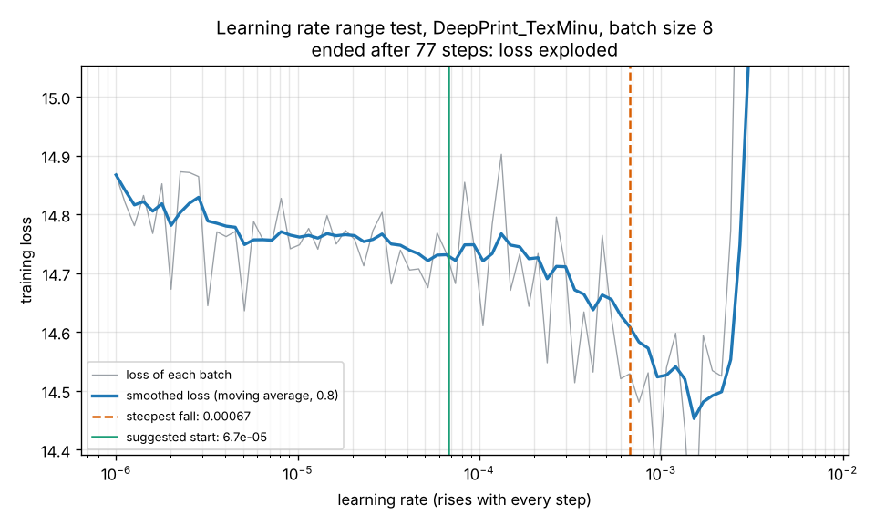

# Settings of the training: learning rate, loss weights, learned alignment

[training-guide.md](training-guide.md) gets a training running with the default settings. This document
explains the three groups of settings that decide whether a training works and how well: what each setting
is, which options set it, what to watch, and how to decide on your own data.

Read "Choosing the learning rate" before the first long training. Read the other two chapters when you want
to compare settings.

The defaults were chosen from short runs on at most 440 real images on a CPU. They were checked for
stability (the training does not break), not for accuracy: no error rate was measured with any setting. The
numbers behind every statement here are in [measurements.md](measurements.md).

## Contents

- [Choosing the learning rate](#choosing-the-learning-rate)
- [Loss weights](#loss-weights)
- [Learned alignment](#learned-alignment)

---

## Choosing the learning rate

### What the learning rate is

Training repeats one small action millions of times. The model looks at a
handful of images (a *batch*), a number called the *loss* says how wrong its
answers were, and the optimizer changes every parameter of the model a little
in the direction that makes the loss smaller. One such action is a *step*.

The *learning rate* is the size of that change. It decides whether a
training works at all:

- **Too low:** every step changes almost nothing. The loss falls very slowly
  or not at all, and GPU time is wasted.
- **Too high:** every step overshoots. The loss jumps up instead of down, the
  next step is computed from a worse model and overshoots further, and within
  a few steps the loss is in the thousands or is no longer a number ("NaN").
  The training has then *diverged* and the model is useless.
- **About right:** the loss falls steadily, with some noise from batch to
  batch.

This repository uses the Adam optimizer. In its first step Adam changes every parameter by about the learning
rate itself, whatever the data look like, and most parameters of a fresh DeepPrint model are small numbers. A
rate of 0.025 therefore destroyed the training in its second step on real images, and 0.01 in its third; the
default of 0.0001 did not (see
[measurements.md](measurements.md#the-default-learning-rate-what-was-measured-and-what-was-not)).

### What warm-up does

At the start the model is random, and the direction that the optimizer
computes from the first few batches is unreliable. *Warm-up* means that the
training starts with a tiny learning rate and raises it in a straight line,
step by step, until it reaches the chosen learning rate. During these steps
the model moves carefully into a region where larger steps are safe.

The warm-up is counted in steps (default: 500). It is never longer than a
tenth of the whole training, so a short training on a small dataset still
reaches the chosen rate; the training prints the number of warm-up steps it
uses. For a large training set, 500 to 2,000 steps are a tiny part of the
first epoch.

After the warm-up there are two choices (the *schedule*):

- `constant`: the rate stays at the chosen value.
- `cosine`: the rate falls smoothly and reaches 1 % of the chosen value in the
  last step of the last epoch. Large steps at the start find a good region
  quickly, small steps at the end settle into it. This is common practice for
  long trainings; whether it gives a lower error rate than `constant` on your
  data was not measured here and is worth one comparison.

### Where the settings are

| Setting | `scripts/train_500k.py` | Default in `flx/setup/config.py` |
|---------|------------------------|----------------------------------|
| Learning rate after the warm-up | `--learning_rate` | `LEARNING_RATE = 0.0001` |
| Number of warm-up steps | `--warmup_steps` | `LEARNING_RATE_WARMUP_STEPS = 500` |
| Schedule after the warm-up | `--lr_schedule constant` or `cosine` | `LEARNING_RATE_SCHEDULE = "constant"` |
| Upper limit for the gradient (see below) | `--gradient_clip_norm` | `GRADIENT_CLIP_NORM = None` (no limit) |
| Stop when the loss is this many times the starting loss | (config only) | `LOSS_EXPLOSION_FACTOR = 10.0` |
| Factor of the learning rate of the localization network (`Loc` variants only, see [Learned alignment](#learned-alignment)) | `--localization_lr_factor` | `LOCALIZATION_LEARNING_RATE_FACTOR = 0.035` |

`scripts/train_500k.py` passes these options on. If you call `fit` yourself, pass the settings to it:

```python
from flx.models.learning_rate import LearningRateConfig

extractor.fit(
    ...,
    learning_rate=LearningRateConfig(
        learning_rate=1e-4, warmup_steps=1000, schedule="cosine"
    ),
)
```

*Gradient clipping* is a safety belt. The *gradient* is the list of changes
that the optimizer would like to make in one step; its *norm* is the overall
length of that list. With a limit, a step whose gradient is longer than the
limit is scaled down to the limit, so a single bad batch cannot throw the
model far away. It is off by default, and the stability runs made here did not
use it. If you use one, take it from your own range test: the column
`gradient_norm` of `lr_range_test.csv` holds the gradient norm of every step,
and a limit of a few times the typical value in the falling part of the curve
only acts on unusual batches. In one range test here the norm was between
10,000 and 15,200 at rates up to 0.0001 and fell to a few hundred near 0.001,
so a limit such as 1.0 from other projects would shrink every single step.

The training follows the schedule by counting steps, so it continues
correctly when you continue a training from `model.pyt`
([Step 7](training-guide.md#step-7-continue-a-training-or-start-again)), as long as the number
of epochs, the training set, the batch size and the number of GPUs are the
same as before. If you continue with a larger number of epochs, the `cosine`
schedule is stretched to the new length and the rate jumps back up; prefer to
set the number of epochs once. `scripts/train_500k.py` points this out when
it happens. In a multi-GPU training all processes use the same rate.

### How to run the range test

The command and its options are in
[Step 5 of the training guide](training-guide.md#step-5-find-a-learning-rate). The test writes
`lr_range_test.csv` (learning rate, loss and gradient norm of every step), draws `lr_range_test.png` and
prints a suggested rate.

### How to read the plot



The picture is the range test of `DeepPrint_TexMinu` on 440 real images with
8 images per step. The fall is shallow because the test is short and the data
set is tiny. The picture was made with an earlier version of the code: the
loss weights were different (today the loss of this variant starts near 138,
not near 15), and the green line was placed by another rule, at a tenth of
the orange one.

The horizontal axis is the learning rate; each tick is ten times the one
before. The grey line is the loss of each batch, the blue line is its moving
average. Read it from left to right:

1. **Flat part on the left.** The rate is too low to change the model in so
   few steps. The loss stays at its starting value.
2. **Falling part.** The model learns. The further right, the faster.
3. **Lowest point and rise on the right.** The rate is too high. The test
   ends when the average loss is four times its lowest value or is no longer
   a number.

A good learning rate lies in the falling part, clearly left of the lowest
point. The lowest point itself is not a good choice: the loss is low there
because of all the steps before it, and the next steps diverge. The script
suggests one tenth of the rate with the lowest smoothed loss (green line).
The factor of ten is a safety margin, because a real training runs thousands
of times longer than the test and an instability can take longer than the
test to show. The script also marks the rate where the loss fell fastest
(orange, dashed) for information; it does not use it (see below).

If the plot has no flat part on the left, start lower (`--min_lr`). If the
loss never falls, no rate is suggested: look for a problem in the data or the
labels before you look at the learning rate.

**Variants with minutiae look different.** Their loss contains the minutia
map loss (see [Loss weights](#loss-weights)), which falls from the first step
at any learning rate: a model that has not learned anything draws a map that
is far from empty, and tiny changes correct that. The curve then has no flat
part and falls evenly from the left edge to the lowest point, and the place
of the steepest fall says nothing about the learning rate. Starting lower
does not help in this case. This is why the suggestion is taken from the
rate with the lowest loss and not from the steepest fall.

### How far to trust the suggestion

The suggestion is a starting point, not a measurement of the best rate. In the six short range tests that
were kept, the suggestions lay between 0.000095 and 0.00027, and two tests that differed only in the seed
were a factor of 2.8 apart
([measurements.md](measurements.md#how-far-to-trust-the-suggestion-of-the-range-test)). So:

- Expect the suggestion to move by a factor of about 3 from one seed to the next.
- Run two or three seeds, take the lowest suggestion, and let the plot and the first thousand steps of a real
  training decide.
- A rate that is 3 times too low costs training time; one that is too high can end the training.

The default of 0.0001 is not a recommendation for your data. It was stable in 110 steps of 8 images; whether
it is a good rate, what happens with a batch of 64 or on several GPUs, and whether a long training stays
stable was not measured.

### How the rate changes with the batch size and the number of GPUs

The training uses a batch of `--batch_size` images per GPU (default 64). With
`torchrun` on several GPUs every GPU processes its own batch and the results
are averaged, so one step sees **`--batch_size` times the number of GPUs**
images. That product is the *effective batch size*, and it is the batch size
that matters for the learning rate.

- A larger effective batch gives a more reliable direction per step, so it
  usually tolerates a higher rate. There is no exact rule for Adam. A
  common first guess is to multiply the rate by the square root of the factor
  by which the effective batch grew (4 GPUs instead of 1: twice the rate).
  Multiplying by the factor itself (4 GPUs: four times the rate) is the upper
  end and often too much. Neither was measured here.
- The safe way is to measure. The range test runs on one GPU. If the
  effective batch fits on one GPU, run the test with it
  (`--batch_size 256` for 4 GPUs). If it does not fit, run the test with the
  largest batch that fits and treat the suggestion as a rate that is on the
  low, safe side for the larger batch.
- More GPUs also mean fewer steps per epoch. The warm-up is counted in
  steps, so it covers more images; this is intended. Use a longer warm-up
  (2,000 steps or more) when you raise the rate for a large batch.
- All parts of the loss are means over the images of a batch, so the balance
  between them does not change with the batch size.

### What to watch in the first thousand steps

The progress bar shows the loss and the learning rate of every step:

```
  3%|▎         | 212/7032 [02:41<1:26:35,  1.31it/s, loss=131.7, lr=4.24e-05]
```

(The line shows the format; its numbers are made up. The loss is the one of
a variant with minutiae shortly after the start, see the next point.)

- **The starting loss.** A fresh model guesses, so each of its classifiers
  starts with a loss near the natural logarithm of the number of training
  subjects (about 10.8 for 50,000 subjects). Variants with texture and
  minutiae have two classifiers. The center loss adds, per classifier, its
  weight (`LOSS_WEIGHT_CENTER`, default 8.0) times the mean squared distance
  between an embedding and the center of its subject. At the start that
  distance is close to 2, because embeddings and centers both have length 1
  and point in unrelated directions; the measured values were 1.95 and 1.98
  (one batch of 8 real images, 256-dimensional embeddings). With 220 subjects
  this gives 2 x 5.4 + 2 x 8.0 x 2 = 42.8, for every batch size. Variants
  with minutiae add the minutia map loss: its weight (default 0.095) times
  about 1,000 for a model that has not learned anything yet (measured: 1,013
  for the first batch of `DeepPrint_TexMinu`). The measured starting loss was
  138 for `DeepPrint_TexMinu` and 145 for `DeepPrint_LocTexMinu`. The map part
  falls fast in the first steps, to about a quarter within 50 steps here,
  because the model quickly learns to draw a nearly empty map; this fall is
  not yet a sign that the model learns to tell fingers apart. A starting
  loss far away from this sum
  points to a problem in the data.
- **During the warm-up** the `lr` value rises and the loss changes little.
  That is normal.
- **After the warm-up** the loss should start to fall within a few hundred
  steps, slowly and with noise. With very many subjects it falls slowly,
  because each subject is seen rarely.
- **Bad signs:** the loss doubles from one step to the next and keeps
  rising; the loss is `nan` or `inf`; the loss swings widely between
  neighbouring steps. The training stops by itself with a message when the
  loss is not a number or more than ten times its starting value, before the
  broken model is saved. The last completed epoch stays in `model.pyt`.
- **If the training stops this way:** divide the learning rate by 3, double
  the warm-up steps, and consider a limit for the gradient. Then start again
  in a new `--output_dir`. (The same `--output_dir` would continue from the
  last completed epoch with the new rate, see
  [Step 7](training-guide.md#step-7-continue-a-training-or-start-again); if the training
  broke in its first epoch there is no such epoch and it starts from
  nothing there too.)
- **If the loss does not move at all for the first thousand steps after the
  warm-up,** the rate is too low (multiply it by 3), or the labels are wrong.

After the first epoch, look at `log.json`: the training loss should be below
the starting loss, and the validation equal error rate should fall from epoch
to epoch. The log also stores the learning rate at the end of every epoch.

---

## Loss weights

### What the loss is made of

The training minimises one number, the *loss*. It is a sum of parts, and each
part is multiplied by a factor, its *weight*:

| Part | What it measures | How it is counted | Weight in `flx/setup/config.py` | `scripts/train_500k.py` |
|------|------------------|-------------------|--------------------------------|-------------------------|
| Cross entropy, once per classifier | How wrong the model is when it names the subject of a training image | Mean over the images of a batch | `LOSS_WEIGHT_CROSS_ENTROPY = 1.0` | `--loss_weight_cross_entropy` |
| Center loss, once per embedding | The squared distance between the embedding of an image and the running average of the embeddings of its subject (the *center*). It pulls the embeddings of one finger together | Mean over the images of a batch | `LOSS_WEIGHT_CENTER = 8.0` | `--loss_weight_center` |
| Minutia map loss (variants with minutiae only) | The squared difference between the minutia map that the model draws and the map made from the minutiae of the image | Sum over the 98,304 cells of a map (6 x 128 x 128), then mean over the images of the batch that have a map | `LOSS_WEIGHT_MINUTIA_MAP = 0.095` | `--loss_weight_minutia_map` |

Variants with texture and minutiae have two classifiers and two embeddings, so
their loss is

```
loss = 1.0 x (cross entropy texture + cross entropy minutiae)
     + 8.0 x (center loss texture + center loss minutiae)
     + 0.095 x minutia map loss
```

`scripts/find_learning_rate.py` has the same three options. In your own
training script, pass the weights when you create the extractor; a weight that
you leave out takes the value from the config:

```python
from flx.extractor.fixed_length_extractor import get_DeepPrint_LocTexMinu
from flx.models.deep_print_loss import LossWeights

extractor = get_DeepPrint_LocTexMinu(
    num_training_subjects, 256, loss_weights=LossWeights(minutia_map=0.01)
)
```

`loss_statistics` in `log.json` holds every part multiplied by its weight.
Divide by the weight to get the part itself.

### What is known about the defaults

- **Minutia map weight 0.095.** It is the value of the DeepPrint paper. In short runs it made the map loss pull
  on the first layers of the model about as strongly as the cross entropy of the texture branch, and the map
  branch learned where the minutiae are. With a weight 30,000 times smaller, which this code used before, the
  map loss did not reach those layers at all.
- **Center weight 8.0.** It keeps what this code did at 64 images per step. It is high: the DeepPrint paper
  states 0.00125 for its center loss. Whether a lower value is better was not tested.
- **No accuracy was measured with any weight.** The runs show which part of the loss reaches which layers,
  not which weights give the better model.

The measurements are in [measurements.md](measurements.md#loss-weights). If you have trainings or logs from
an earlier version of this code, read
[Changes against earlier versions](measurements.md#changes-against-earlier-versions-and-what-to-do-with-old-files):
the loss was different, and the weights that restore it are given there.

### How to compare settings on your data

To decide on your data, train the same model with two or three settings for a
few epochs and compare the validation equal error rate, for example the map
weights 0.095, 0.01 and 1.0, and the center weights 8.0 and 0.5. Change one
weight at a time, and repeat the learning rate range test for each setting,
because the weights change the size of the loss and of its gradient.

The recipe for such a comparison (same images, same validation subjects, repeats) is the one under
[How to find out whether it helps on your data](#how-to-find-out-whether-it-helps-on-your-data) below, with a
loss weight in place of `--localization` as the one thing that differs.

---

## Learned alignment

### What the localization network is

Two impressions of the same finger are rarely placed on the sensor in the
same way: one is rotated or shifted against the other. *Alignment* means
bringing every image into a similar pose before the model compares them.

The variants whose name starts with `Loc` (`DeepPrint_LocTex`,
`DeepPrint_LocMinu`, `DeepPrint_LocTexMinu`) do this with a *localization
network*: a small network in front of the model that looks at a reduced copy
of the image and proposes a rotation and a shift. The image is resampled with
them, and the rest of the model only sees the result, the *aligned image*.
Nobody tells the localization network which pose is the right one. It is
trained together with the model, by the same loss, so it learns whatever
alignment makes the fingers easiest to tell apart. This is the design of the
DeepPrint paper (Engelsma, Cao and Jain, 2019, section 3.2).

The variants without `Loc` have no alignment step. The paper that this
repository belongs to states that it did not consider the alignment step.

### What keeps it stable

A localization network can ruin a training without any sign in the loss: if
it moves the prints out of the frame, the model trains on empty images. In
runs with a learning rate that was far too high this happened within four
steps, and in one of them the loss fell while every image was empty. The
following settings prevent it:

| Measure | What it does | Setting in `flx/setup/config.py` | `scripts/train_500k.py` |
|---------|--------------|----------------------------------|-------------------------|
| Bounds | The network cannot rotate by more than 60 degrees or shift by more than half the image side, whatever its weights are. These are the bounds of the DeepPrint paper (224 pixels of its 448 pixel images). The raw outputs pass through `tanh`, a smooth function that never leaves -1 to 1, and are multiplied by the bound. A fresh network proposes no rotation and no shift (the *identity*). | `LOCALIZATION_MAX_ROTATION_DEGREES = 60.0`, `LOCALIZATION_MAX_SHIFT = 0.5` | not an option |
| Scale | The scale is fixed, as in the paper. A value above 1.0 lets the network also enlarge or reduce the print by up to that factor; this adds an output to the network, so parameter files of the two kinds do not fit each other. No training was run with it. | `LOCALIZATION_MAX_SCALE_FACTOR = 1.0` | not an option |
| Own learning rate | The localization network uses the learning rate of the other parameters times a factor, in every step. The paper states that its network did not converge properly without this and gives 0.035. The alignment decides what the whole model sees, so it should change more slowly than the model that learns from it. | `LOCALIZATION_LEARNING_RATE_FACTOR = 0.035` | `--localization_lr_factor` |
| Check for empty images | In every step, before the parameters change, the training counts the aligned images that are *mostly empty*: less than half of the frame shows the input image, or less than half of the print is still in the frame. It prints a warning (once per epoch) when more than 10 % of a batch is mostly empty and stops with an error when more than 50 % is. The check costs two sums over the batch. | `ALIGNMENT_EMPTY_BELOW = 0.5`, `ALIGNMENT_WARN_SHARE = 0.1`, `ALIGNMENT_STOP_SHARE = 0.5` | not an option |

"Share of the print" means the sum of the pixel values of the aligned image
divided by that of the input. This works for images with background 0 and
bright ridges, which is what the binarization step of the training pipeline
delivers. If you feed images with a bright background, only the share of the
frame is meaningful.

One more point concerns the variants with minutiae. The model draws its
minutia map for the aligned image, so the target map must be in the frame of
the aligned image too. The loss moves the target map with the rotation
and shift that the localization network predicted for each image. The moved
target is cut off from the gradient, so the localization network cannot
lower the loss by moving or blurring its own target. A sample whose minutiae
all left the frame does not count in the map loss.

The target map is resampled, not drawn again from the transformed minutiae. Against maps drawn again, the
resampled maps had a mean correlation of 0.94 to 0.97
([measurements.md](measurements.md#the-resampled-target-map)).

### Switching it on and off

`scripts/train_500k.py` trains with the localization network by default and
without it on request. Nothing else differs between the two:

```bash
# With learned alignment (the default): DeepPrint_LocTexMinu,
# or DeepPrint_LocTex without --minutiae_dir
python scripts/train_500k.py --localization on  ...

# Without: DeepPrint_TexMinu, or DeepPrint_Tex without --minutiae_dir
python scripts/train_500k.py --localization off ...
```

With a sample table (`--samples`) the table takes the place of `--minutiae_dir` in these comments: the variant
has the minutia branch if the table holds minutiae for training images and `--ignore_minutiae` is not given
([sample-table.md](sample-table.md#the-range-test-and-the-training-from-a-table)).

A parameter file must be loaded into the variant it was trained with: a model
trained with `--localization on` and minutiae is loaded with
`get_DeepPrint_LocTexMinu`, one trained with `--localization off` with
`get_DeepPrint_TexMinu`.

In your own training script the choice is the constructor
(`get_DeepPrint_LocTexMinu` or `get_DeepPrint_TexMinu`), and the factor is
`LearningRateConfig(localization_factor=...)`.

### What to watch

For `Loc` variants the training prints a line after every epoch and stores
the same numbers in the field `alignment` of `log.json`:

```
Learned alignment: mean rotation 3.10 degrees (largest 14.20), mean shift
0.021 of the image side (largest 0.090), share of the print kept in the frame
98.7% on average (lowest 81.3%), 0.0% of the aligned images mostly empty
```

(The numbers in this example are made up to show the format.)

- **Rotation and shift near 0 in every epoch** mean that the localization
  network does nothing. The model then behaves like the variant without it.
  This is what a short training looks like (see the measurements linked below). If
  it stays like this to the end of a long training, the network has not
  learned an alignment; try a larger `--localization_lr_factor`.
- **Largest rotation at 60 degrees or largest shift at 0.5** means that the
  network runs into its bounds. Look at aligned images of such samples.
- **A falling share of the print kept in the frame, or warnings about mostly
  empty images,** mean that the network pushes prints out of the frame. Lower
  `--localization_lr_factor`, or tighten `LOCALIZATION_MAX_SHIFT`.
- **The training stops with `AlignmentCollapsedError`:** more than half of a
  batch was mostly empty. The parameters of that epoch were not saved. Start
  again with a lower factor or tighter bounds, or train without localization.
  A lower `--localization_lr_factor` can be given to the same `--output_dir`:
  the training then continues from the last completed epoch with the new
  factor. Training without localization is another model variant and needs a
  new `--output_dir`.

To look at aligned images yourself:

```python
import torch

# extractor and image_loader as in Step 9 of the training guide
# (load_trained_model), for a Loc variant
model = extractor.model
model.eval()
images = torch.stack([image_loader.get(i) for i in image_loader.ids[:8]])   # (8, 1, 299, 299)
with torch.no_grad():
    aligned, alignment = model.localization.align(images)
# rotation in radians (torch.rad2deg gives degrees), shift as a share of the
# image side, kept_content as the share of the print that stayed in the frame
print(alignment.rotation, alignment.shift, alignment.kept_content)
```

### What is known about it

Short runs on 400 real images
([measurements.md](measurements.md#what-was-measured-about-the-alignment-and-what-was-not)) showed:

- With the default factor 0.035 the training was stable for 300 steps, and the localization network did not
  move away from "no rotation, no shift". The model was in effect the variant without it.
- With a factor of 30 the network pushed the prints out of the frame within 23 steps while the loss kept
  falling; the check stopped the training. A factor of 5 was stable for 150 steps.
- **In no run did the alignment bring differently placed copies of the same print closer together.**
- Whether the network learns a useful alignment in a training that is long enough for the model to learn, and
  whether it makes matching more accurate, was not measured.

`scripts/train_500k.py` keeps the localization network on by default because the default settings were stable
in these runs and a collapse stops the training instead of passing unnoticed. This is not a statement that it
helps.

### How to find out whether it helps on your data

Train the same model twice, once with and once without the localization
network, and compare the error rates on fingers that neither training has
seen. This is called an A/B run. The recipe:

1. **Choose a subset that you can afford to train several times**, for
   example 20,000 to 50,000 fingers with all their impressions, drawn at
   random from all sensor types. Both runs must use exactly the same images.
   The answer from a subset is an indication for the full training, not a
   guarantee.
2. **Choose the learning rate for each variant** with the range test (see
   [Choosing the learning rate](#choosing-the-learning-rate)), with the batch
   size of the planned runs. The dots stand for the other options of the
   command in Step 5 of the training guide:

   ```bash
   python scripts/find_learning_rate.py --variant LocTexMinu --output_dir lr_with    ...
   python scripts/find_learning_rate.py --variant TexMinu    --output_dir lr_without ...
   ```

   If the two suggestions differ by less than a factor of 3 (the suggestion
   moves that much from one seed to the next), use the lower
   one for both runs. Otherwise give each variant its own rate, and write
   down that you did.
3. **Run both trainings with the same options.** Only `--localization` and
   `--output_dir` differ:

   ```bash
   COMMON="--dataset_dir /data/subset --minutiae_dir /data/subset_minutiae \
           --ppi_manifest /data/subset_resolutions.csv \
           --num_subjects 20000 --num_impressions 10 \
           --validation_split 0.1 --max_validation_subjects 2000 --validation_seed 42 \
           --num_epochs 10 --patience 3 --learning_rate 0.0001"

   python scripts/train_500k.py $COMMON \
       --localization on  --output_dir /models/ab_with_1
   python scripts/train_500k.py $COMMON \
       --localization off --output_dir /models/ab_without_1
   ```

   The paths and numbers are examples. On several GPUs, put `torchrun --nproc_per_node=4` in place of
   `python` in both commands ([large-datasets.md](large-datasets.md#several-gpus); not run here). With a
   sample table, `--samples` with the table takes the place of `--minutiae_dir`, `--ppi_manifest`,
   `--num_subjects` and `--num_impressions` in `COMMON` ([sample-table.md](sample-table.md)).

   The same `--validation_seed`, `--validation_split` and
   `--max_validation_subjects` give both runs the same held-out subjects and
   the same comparison pairs. Use the same number of GPUs for both, because
   the number of GPUs changes the effective batch size.
4. **Repeat each run at least once more** (`ab_with_2`, `ab_without_2`;
   three of each is better). The script does not fix the random numbers of
   the model initialisation and of the batch order, so two runs of the same
   command give slightly different error rates. Without repeats you cannot
   tell a real difference from this noise.
5. **Check that the localization network did something.** In `log.json` of
   the runs with localization, the field `alignment` should show a mean
   rotation or shift clearly above 0 in the later epochs, and no mostly empty
   images. If it stays near 0, the two variants were the same model in
   effect, and the comparison says nothing about alignment; raise
   `--localization_lr_factor` step by step (for example to 0.1, then 0.3,
   then 1) and repeat the runs with localization. In the short runs made here, 5
   was still stable and 30 pushed the prints out of the frame within 23
   steps.
6. **Compare the validation equal error rate (EER) of the best epoch.** Lower
   is better.

   ```python
   from flx.models.model_training import TrainingLog

   for name in ["ab_with_1", "ab_with_2", "ab_without_1", "ab_without_2"]:
       best = TrainingLog(f"/models/{name}/log.json").best_entry
       print(name, best.epoch, best.validation_equal_error_rate)
   ```

   The localization network helps on this data if every run with it has a
   lower EER than every run without it, and the gap between the two groups
   is clearly larger than the spread inside each group. If the groups
   overlap, the data do not show a difference at this size.
7. **Also compare on the pairs you care about.** The validation images of
   `train_500k.py` are in the pose in which they were captured (the random
   rotation and shift are applied to training images only). If your prints
   are placed consistently, for example rolled prints on a card or a guided
   sensor, there is little pose variation for the alignment to remove, and
   it can only show its value on pairs with different placement: a rolled
   print against a slap print, or prints from different sensor types. Build
   a test set of such pairs from the held-out subjects, extract the
   embeddings with the best model of each run
   ([Step 9](training-guide.md#step-9-extract-embeddings)) and run the verification
   benchmark ([Step 10](training-guide.md#step-10-run-a-verification-benchmark)) on it.
8. **Decide.** Keep the localization network if it wins in steps 6 and 7.
   If it makes no difference, the variant without it is the simpler model.
   If it is worse, train without it.

How many comparisons the validation set needs: an error rate *e* measured on
*n* independent comparisons is uncertain by about the square root of
*e* (1 - *e*) / *n*. For an EER of 1 % measured on 20,000 non-mated pairs
(2,000 validation subjects, 10 pairs each) that is 0.07 percentage points, so
differences below about 0.2 percentage points cannot be seen with that set.

Whether the localization network improves matching on your data cannot be
said from the measurements made for these documents. It has to be measured
with this A/B run.
